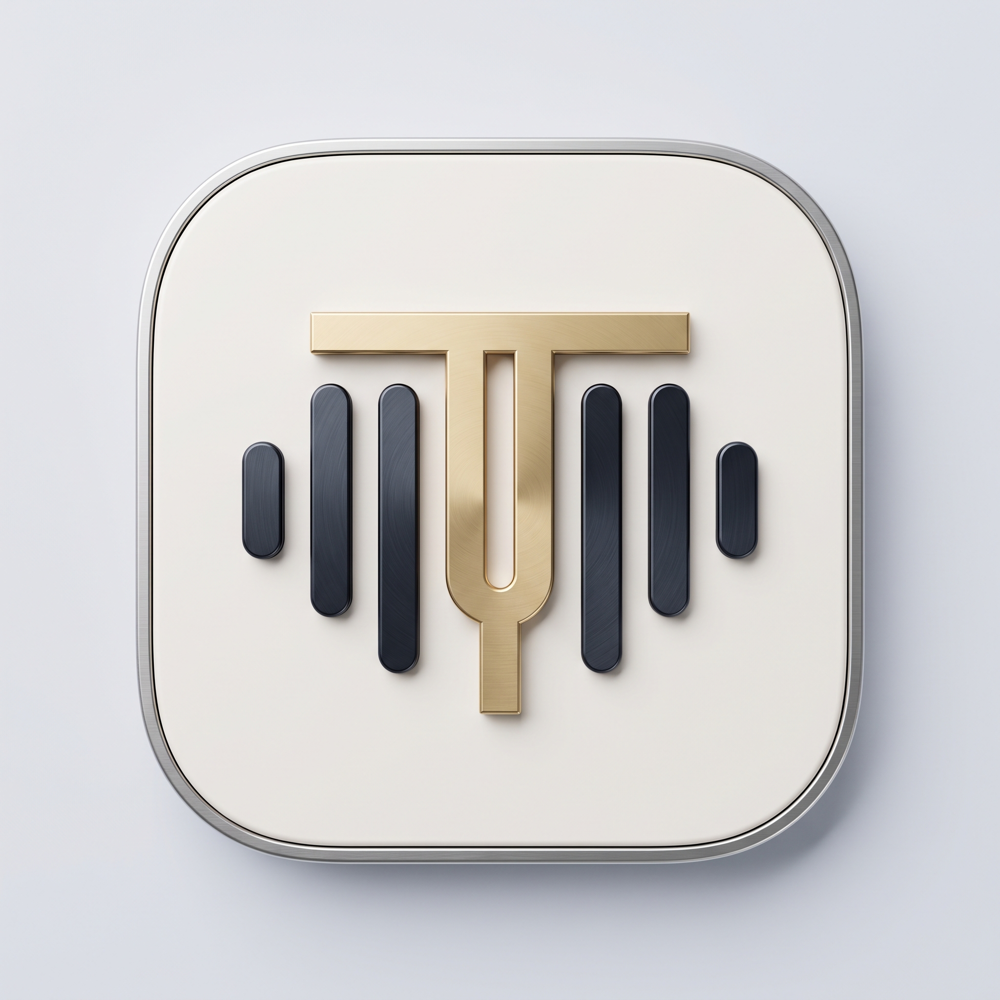
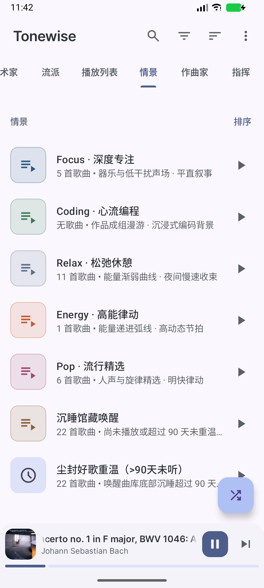
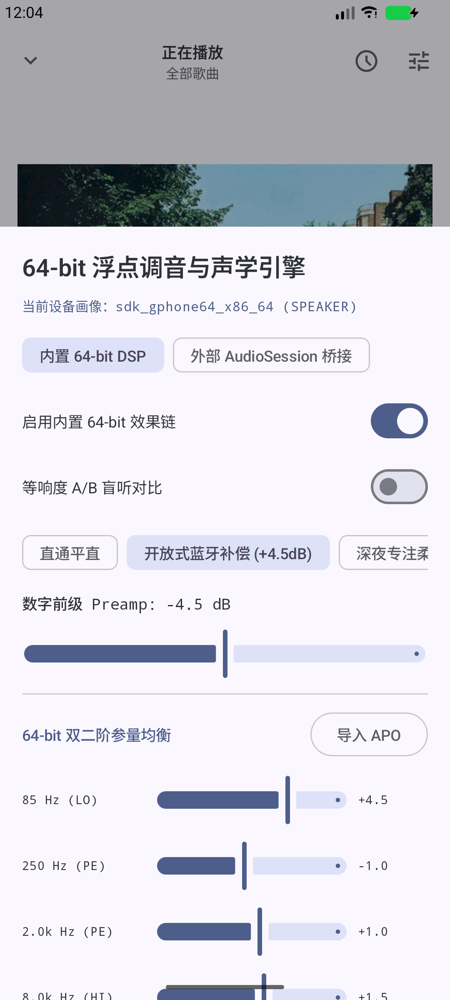
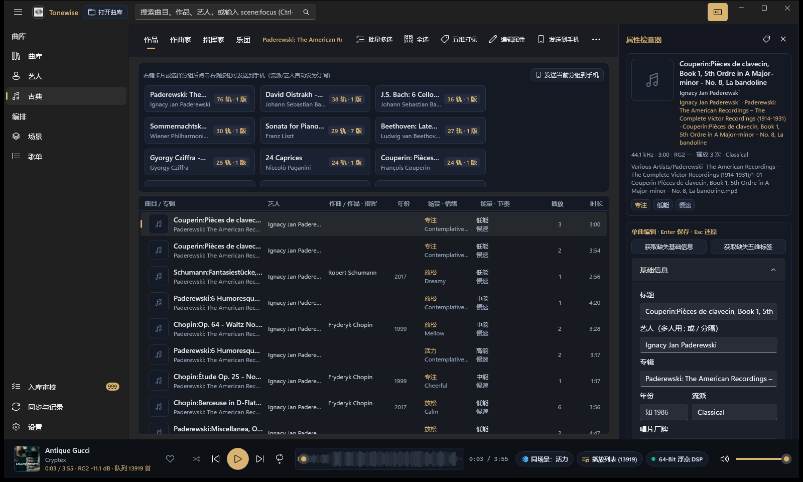
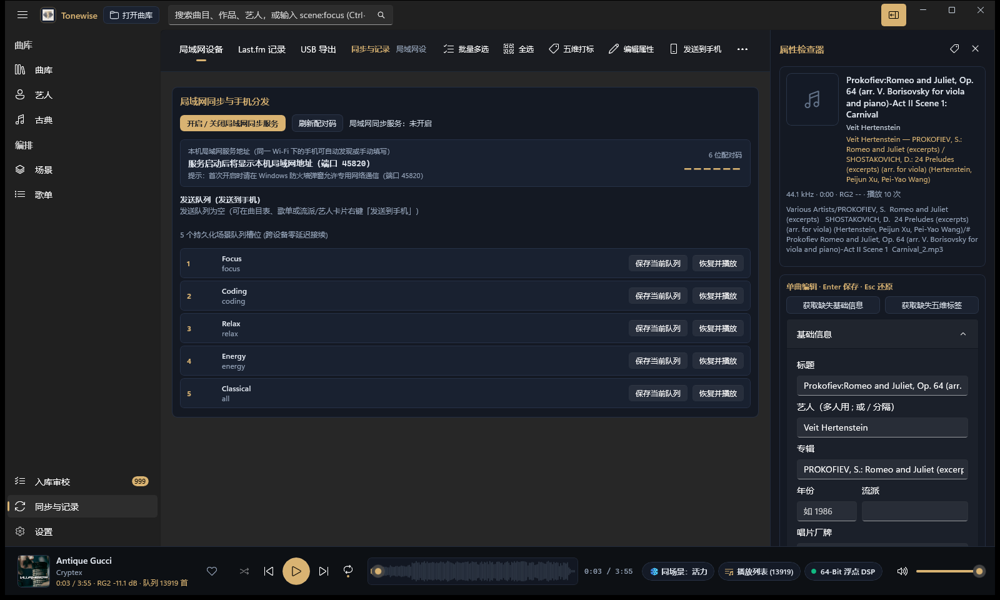

<p align="center"></p>
<h1 align="center"><b>Tonewise 知律</b></h1>
<h4 align="center">懂作品的章法，亦懂入景的直觉。Structured for works. Built for scenes. Bit-perfect to the ear.</h4>

<p align="center"></p>

## About

流媒体时代不缺音乐入口，缺的是一套真正尊重专辑叙事与录音本貌的本地听音器物。通用播放器往往按流行单曲逻辑设计：交响曲的完整乐章被随机打碎，爵士三重奏里的伴奏名家无处检索，精心抓轨的数百张无损专辑最终困在繁琐的目录层级里吃灰。

**Tonewise（知律）** 是一款面向古典、爵士与摇滚本地无损曲库打造的开源跨端本地音乐系统（GPL-3.0）。项目以 **Rust 同源核心库 (`core/`) + Windows 11 原生桌面端 (`desktop/`) + Android 深度定制端 (`android/`, 基于 [Auxio](https://github.com/OxygenCobalt/Auxio)) + `.tonewise/` 双端同步协议 (`protocol/`)** 构成“PC 重算力策展与母带直通 + 手机随身零摩擦入景 + 局域网无云同步”的完整本地听音体系。

### 当前实现状态（Tonewise `v0.7.0` · `com.shawnshi.tonewise` `versionCode 76`）

* **Rust 同源内核 (`core/`)**：完成 `tonewise-metadata`、`tonewise-rules`、`tonewise-dsp-core`、`tonewise-sync`、`tonewise-ffi`、`tonewise-cli` 六大 crate 构建与双端 JNI/FFI 对齐（`build-core-android.ps1` / `build-core-desktop.ps1`）。
* **Windows 11 桌面端 (`desktop/`)**：完成 P1–P4、R1–R8 与工作台深度重构：
  * **母带级 64-bit 声学引擎 (`Tonewise.Audio`)**：Event-Driven WASAPI Exclusive / `AsioOut` 输出、`.dsf`/`.dff` 原生 DSD→`352.8 kHz / 64-bit DXD` 抽取解调、Stereo Linked & L/R 独立 64 段 EqualizerAPO 解析与按设备声学档案匹配、ISO 226 动态等响度、零延迟分区 FFT FIR 卷积（支持 REW `.wav` 与 `.sofa` 双耳脉冲）、沙盒化共享内存 VST3 宿主桥、`±1 LSB` TPDF 抖动、Shared 模式 Equalizer APO 注册表冲突锁、基于真实样本流 EOF 检测的真无缝队列连播（`GaplessSampleProvider`）、ReplayGain 四模式增益解析（`ReplayGainResolver`）、与移动端对齐的 64-bit 扩展调音链（`DesktopDspChainConfig`：10 段 PEQ / Bauer Crossfeed / 声道平衡 / 单声道折叠 / `-0.2 dBFS` 软限幅 / 等响度 A/B 盲听对比）、古典整部作品原子随机排序（`WorkAwareShuffleEngine`）与播放进度会话持久化（`PlaybackSessionStore`）；
  * **音乐信息维护与防毁库审校台 (`Tonewise.SyncHost/Curation`)**：贯彻“只补空缺”与“暂存对比台先审后写”双铁律，入库审校台支持单行 10 维缺标筛选（流派/作曲/指挥/专辑/厂牌/场景/节奏/封面/人声标签/90 天未听），`StagingDiffStore` 支持 `lofty` 物理音频文件头事务回写（保持纯音频 `audio_frame_blake3` 不变）与按批次一键回滚；内置 `<Album Artist>\<Album>\<Disc-Track#> <Title>` 文件夹规范整理、Windows 超长路径（`\\?\`）与不可访问目录容错，以及基于 `FileSystemWatcher` 的防抖实时曲库监测（`LibraryFolderOrganizerService` / `LongPathHelper` / `LibraryFileWatcherService`，自动同步新增、移动、重命名或删除的音频与 `.m3u8` 歌单）；支持本地路径启发式→Apple iTunes Search (`cn`/`us`/`jp`)→MusicBrainz→豆瓣音乐→Last.fm 多源基础属性与封面瀑布（Cover Art Archive → iTunes → Last.fm）、MusicBrainz→Wikidata→Wikipedia/豆瓣音乐独立传记库（`/Music/.tonewise/encyclopedia.db`）、`symphonia` 声学五维推理与 AcoustID 原盘消歧；
  * **Last.fm 全量账本与双端同步 (`Tonewise.SyncHost`)**：集成 `LastFmWebApiClient` 并发分页拉取（支持 `user.gettoptracks`、`user.getlovedtracks`、`user.getrecenttracks` 全量同步，含繁简中文归一化、`Remastered`/`Live`/`feat.` 版本后缀剥离与同曲多副本匹配）、Last.fm 实时回传闭环（浏览器 OAuth 授权、遵循时长与防拖拽阈值 `PlaybackScrobbleEvaluator` 的 `track.updateNowPlaying` / `track.scrobble` 自动上报与 `track.love` / `track.unlove` 离线去重重试队列）及 `effective_play_count = max(legacy, lastfm_pulled) + local_unsynced_expired` 账本；提供 `_tonewise._tcp` mDNS + HTTP/2 `SyncHostServer`（含 `/api/v1/` 增量补丁与 `/api/v2/` 局域网同步：`SyncOutboxAndPairingStore` 6 位配对码 Bearer Token 设备配对与解绑、支持歌单/流派/艺人/单曲/多选曲目五类粒度的单次发送与订阅模式、HTTP `Range` 断点续传音频与封面分发，以及手机端播放与标签变更幂等回写）及 BOM-free 相对路径车载 U 盘 `.m3u8` 导出器；
  * **曜石黑工作台与微挂件 (`Tonewise.Desktop`)**：`#131720` + `#D9B372` 高密度三栏工作台、可点击 8 列表头升/降序排列、单/多曲复选批量编辑检查器（共有字段自动预填、按流派自动展开古典信息）、基于当前时段的 AutoDJ 智能排曲（70% 常听 + 30% 少听/未听探索并约束邻曲能量与 BPM 过渡）、底部增强播放控制栏（红心快捷喜爱、ReplayGain 增益指示、同场景胶囊、实时波形进度条与 64-bit DSP 状态切换）、曲目表/歌单/艺人/流派卡片一键「发送到手机」、顺序/随机与循环控制、Windows SMTC + Win32 全局热键（`Ctrl+Alt+P/C/M`）及防烧屏副屏 OLED 微挂件。
* **Android 客户端四阶段演进 (`android/` S1–S4 及 v0.7.0 增强)**：
  * **S1 — 64-bit 浮点调音引擎与双模直通链路**：`TonewiseDspEngine` 5 级 `Double` 串联管线（Preamp → 10 段 RBJ Biquad PEQ / EqualizerAPO 导入 → Bauer 双耳 Crossfeed → 声道平衡/相位/单声道折叠 → `-0.2 dBFS` 3ms 前瞻软限幅）、按设备声学存档（`DspRepository`）、等响度 A/B 盲听对比、Android 14+ USB DAC `BIT_PERFECT` 硬件直通与采样率切换重武装、外置 `AudioSession`（Wavelet / RootlessJamesDSP）互斥以及 HyperOS/Dolby 系统音效冲突提示。
  * **S2 — 古典多版本作品索引与原子洗牌**：`:musikr` 新增 `WORK` / `MOVEMENTNAME` / `MOVEMENTNUMBER` / `MUSICBRAINZ_WORKID` / `MOOD` 标签解析（缓存库升至 v73，v0.7.0 升级至 v75 支持两阶段瞬时冷启动预热与后台静默刷新）、`ClassicalWork` 同作品多演绎版本聚合、屏幕 C 演绎版本对比（`WorkRecordingsDialog` 同步切歌至对应乐章与播放进度）以及整部作品不拆散的原子随机排序（`WorkShuffleOrder`）。
  * **S3 — 古典四元组排版与数码画册**：播放界面支持“作曲家—作品名—乐章—演绎者/指挥”古典四元组衬线排版（`Typeface.SERIF`）与 1:1 直角封面（`CoverView` / `PlaybackMaskableFrameLayout`），保持精简元数据区并在顶部工具栏直达全链路信号路径（`SignalPathDialog`）及基于原生 `PdfRenderer` 的零依赖 `BookletPdfDialog` 数码画册阅读器。
  * **S4 — 独立情景与专注页签、演职员视图、Last.fm 自动回传与局域网同步**：`Library` 主导航新增独立 **Scenes** 与 **Focus** 专注页签（支持五维场景卡片手动排序、交互式 DJ 标签筛选与 `QuickTagDialog` 快捷五维打标）、独立作曲家/指挥家视图与排序（`PersonListFragment` / `ComposerSortDialog` / `ConductorSortDialog`），顶部保留 `SceneContextPill` 快捷热切 5 槽位持久队列，同步中心集成 Last.fm Web API v2.0（`auth.getMobileSession` / `track.updateNowPlaying` / `track.scrobble` / `track.love` / `track.unlove` 自动上报与离线重试队列）、系统广播 Scrobble（`com.adam.aslfms`）与 `TonewiseSyncDatabase` 离线增量同步库、6 位配对码局域网精细化同步（歌单/流派/艺人/单曲或多首曲目）、2 秒防抖无 BOM UTF-8 POSIX `.m3u8` 回写及纯黑防烧屏 OLED `DeskClockDialog`；同步升级全幅无留白自适应与多密度应用图标。

## Release Download / 发行包下载

仓库已随附最新构建并校验的双端 Release 发行包：

| 平台 | 安装包 / 发行归档 | 版本与运行环境 | 文件大小 | SHA-256 |
| :--- | :--- | :--- | :--- | :--- |
| **Android** | [releases/tonewise-android-release.apk](releases/tonewise-android-release.apk) | `com.shawnshi.tonewise` · `v0.7.0` (`versionCode 76`) | `15,637,750` bytes (~14.91 MiB) | `9484c144eab901284144972558dc59652e480fbc12b39cb4cf1209ab96c50178` |
| **Windows x64** | [releases/tonewise-windows-x64-release.zip](releases/tonewise-windows-x64-release.zip) | `v0.7.0` · WinUI 3 (`net9.0-windows10.0.26100.0` + 含 `tonewise_core.dll` & `tonewise-cli.exe`) | `50,319,503` bytes (~47.99 MiB) | `0a84230e390b200345e9293dd60915102eb2a4ac7f23805c5e0aa82da1810d06` |

* **Android 签名说明**：已通过 `zipalign` 4 字节对齐与 `apksigner` v2/v3 签名校验（当前使用开发者本机调试签名密钥 `CN=Android Debug, O=Android, C=US` 封装，可直接侧载安装体验；正式商店分发请替换为独立发布密钥签章）。
* **Windows x64 运行说明**：解压 `tonewise-windows-x64-release.zip` 后直接运行 `Tonewise.Desktop.exe`（需安装 .NET 9 Desktop Runtime；Windows App SDK 1.7 与 Rust `tonewise_core.dll` / `tonewise-cli.exe` 已随压缩包自包含打包）。

## Screenshots

### Android 移动端（v0.7.0 核心界面）

| 情景与专注导航 | 专辑与曲库浏览 | 古典四元组播放与波形进度条 |
| :---: | :---: | :---: |
|  |  |  |
| **64-bit 浮点参量均衡与调音引擎** | **Focus 正反选布尔漏斗** | **5 槽位接力、Last.fm 与局域网同步** |
|  |  |  |

### Windows 桌面端（v0.7.0 工作台精选）

| 桌面曲库与增强播放栏 | 古典作品与多版本演绎 |
| :---: | :---: |
|  |  |
| **场景编排与 AutoDJ** | **局域网 6 位配对码与精细化同步** |
|  |  |

## Current Android Features

* **Media3 & 无损软解内核**：基于定制版 [Media3 ExoPlayer](https://developer.android.com/guide/topics/media/exoplayer) + FFmpeg FLAC/ALAC 解码 + Rust `tonewise-core` JNI 原生能力
* **发烧级音频路径与 64-bit DSP**：USB DAC `BIT_PERFECT` 硬件直通、5 级 64-bit Biquad PEQ / Bauer Crossfeed / 软限幅、EqualizerAPO 导入、等响度 A/B 盲听对比与信号路径 4 段实时监控
* **古典音乐一等公民支持**：`WORK` / `MOVEMENTNAME` / `MOVEMENTNUMBER` / `MUSICBRAINZ_WORKID` / 作曲家 / 指挥深度索引、独立作曲家/指挥家视图与专项排序（`PersonListFragment` / `ComposerSortDialog` / `ConductorSortDialog`）、同作品多版本同乐章对比切换、原子乐章随机排序、衬线四元组视图与 `PdfRenderer` 数码画册阅读
* **多维详情与传记体系**：曲目列表展示 `album` / `year` / `play count` / `genre`；专辑、艺术家、作曲家、指挥详情页支持本地及缓存传记展示
* **极速冷启动、Last.fm 自动回传与局域网零云同步**：`CacheDatabase` v75 两阶段瞬时加载与后台静默刷新，**Scenes** / **Focus** 页签与 `QuickTagDialog` 快捷五维打标，支持 **Last.fm** 实时 `track.updateNowPlaying` / `scrobble` / `love` / `unlove` 自动推送与离线队列、Android 系统 Scrobbler 广播、5 槽位持久队列热切换、`_tonewise._tcp` mDNS + 6 位配对码局域网按歌单/流派/艺人/曲目精细化同步、150 点静态 RMS 波形进度条、防抖 `.m3u8` 导出与 OLED 防烧屏桌面时钟
* **高完成度本地播放器基础**：Material Design Expressive 交互、SAF/MediaStore 双后端、无缝播放、完整 ReplayGain 与 Android Auto / 桌面微件支持

## Permissions

* Storage (`READ_MEDIA_AUDIO`, `READ_EXTERNAL_STORAGE` maxSdk 32) to read local music directories and liner note booklets
* Services (`FOREGROUND_SERVICE`, `FOREGROUND_SERVICE_MEDIA_PLAYBACK`, `FOREGROUND_SERVICE_DATA_SYNC`, `WAKE_LOCK`) for background playback and LAN sync
* Notifications (`POST_NOTIFICATIONS`) for ongoing media playback and library indexing status
* Local Network (`INTERNET`, `ACCESS_NETWORK_STATE`, `CHANGE_WIFI_MULTICAST_STATE`) strictly for `_tonewise._tcp` LAN SyncHost discovery/transfer and optional metadata lookup

## Workspace Structure

```text
Tonewise/
├── android/    # Android 客户端 Gradle 工程 (:app, :musikr, vendored media/, patches/)
├── core/       # Rust tonewise-core 双端同源内核与离线回填 CLI
├── desktop/    # Windows 11 原生桌面端 (.NET / C# / WinUI 3) 与 SyncHost
├── protocol/   # .tonewise/ 双端同步协议 Schema、字典与回归夹具
├── releases/   # 已构建校验的 Android APK 与 Windows x64 ZIP 归档
├── scripts/    # 跨端构建脚本 (apply-media-patch, build-core-android, build-core-desktop)
└── docs/       # 设计方案 (specs/)、声学调研 (research/) 与视觉资产 (assets/)
```

## Building (Windows 11)

Tonewise builds natively on Windows 11 with PowerShell 7 (JDK 21, CMake 3.22.1+, Ninja, Android NDK `28.2.13676358`, Rust stable toolchain, and .NET SDK for `desktop/`).

### 1. Clone, patch Media3, and build `tonewise-core` JNI/Desktop libs

```powershell
git -c core.autocrlf=false -c core.symlinks=true -c core.longpaths=true clone --recurse-submodules https://github.com/shawnshi/Tonewise.git
cd Tonewise
.\scripts\apply-media-patch.ps1
.\scripts\build-core-desktop.ps1
.\scripts\build-core-android.ps1
```

### 2. Prepare FFmpeg static libraries once (MSYS2 UCRT64)

`musikr` builds TagLib for all four Android ABIs automatically with CMake on Windows. For the patched Media3 FFmpeg decoder, build the static libraries once inside an MSYS2 UCRT64 shell:

```bash
pacman -Syu
pacman -S --needed base-devel diffutils nasm perl mingw-w64-ucrt-x86_64-gcc

module="$(cygpath -u "$PWD/android/media/libraries/decoder_ffmpeg/src/main")"
sdk="$(cygpath -u "${ANDROID_HOME:-$LOCALAPPDATA/Android/Sdk}")"
ndk="$sdk/ndk/28.2.13676358"
bash "$module/jni/build_ffmpeg.sh" "$module" "$ndk" windows-x86_64 21 flac alac
```

### 3. Build & test Android with Gradle

```powershell
Set-Location android
.\gradlew.bat :musikr:testDebugUnitTest :app:testDebugUnitTest :app:assembleDebug
.\gradlew.bat :app:assembleRelease
```

### 4. Connecting and installing on an Android device

```powershell
adb devices
Set-Location android
.\gradlew.bat installDebug
# Or sideload the release package from repo root:
adb install -r ..\releases\tonewise-android-release.apk
```

### 5. Build & test Windows Desktop (`desktop/`)

```powershell
cargo test --manifest-path core\Cargo.toml --workspace
.\scripts\build-core-desktop.ps1
dotnet build desktop\Tonewise.sln -c Release -p:Platform=x64
dotnet test desktop\Tonewise.sln
```

## License

[](https://www.gnu.org/licenses/gpl-3.0.en.html)

Tonewise is Free Software: You can use, study, share and improve it at your will. Specifically you can redistribute and/or modify it under the terms of the [GNU General Public License](https://www.gnu.org/licenses/gpl.html) as published by the Free Software Foundation, either version 3 of the License, or (at your option) any later version.
