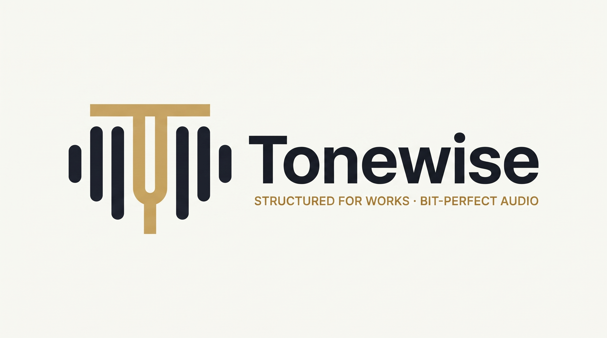
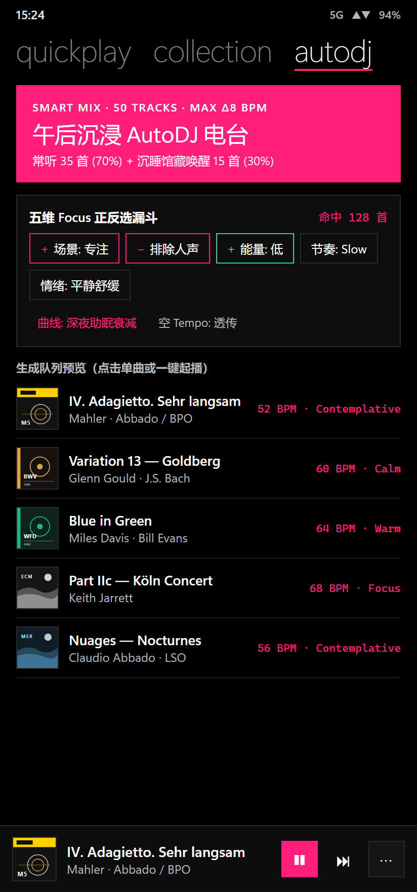
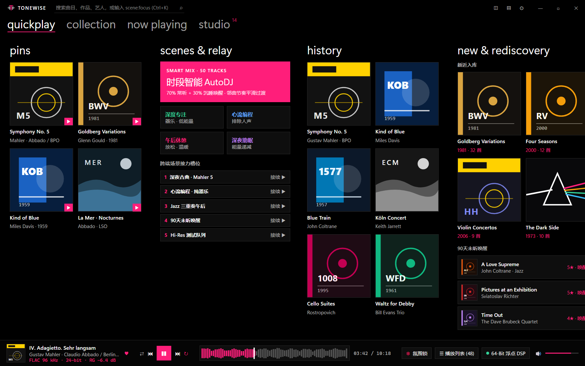

<p align="center"></p>
<h1 align="center"><b>Tonewise 知律</b></h1>
<h4 align="center">懂作品的章法，亦懂入景的直觉。Structured for works. Built for scenes. Bit-perfect to the ear.</h4>

<p align="center"></p>

## About

流媒体时代不缺音乐入口，缺的是一套真正尊重专辑叙事与录音本貌的本地听音器物。通用播放器往往按流行单曲逻辑设计：交响曲的完整乐章被随机打碎，爵士三重奏里的伴奏名家无处检索，精心抓轨的数百张无损专辑最终困在繁琐的目录层级里吃灰。

**Tonewise（知律）** 是一款面向古典、爵士与摇滚本地无损曲库打造的开源跨端本地音乐系统（GPL-3.0）。项目以 **Rust 同源核心库 (`core/`) + Windows 11 原生桌面端 (`desktop/`) + Android 深度定制端 (`android/`, 基于 [Auxio](https://github.com/OxygenCobalt/Auxio)) + `.tonewise/` 双端同步协议 (`protocol/`)** 构成“PC 重算力策展与母带直通 + 手机随身零摩擦入景 + 局域网 / USB 无云同步”的完整本地听音体系。

### 当前实现状态（Tonewise `v1.0.7` · `com.shawnshi.tonewise` `versionCode 107`）

* **Rust 同源内核 (`core/`)**：完成 `tonewise-metadata`、`tonewise-rules`、`tonewise-dsp-core`、`tonewise-sync`、`tonewise-ffi`、`tonewise-cli` 六大 crate 构建与双端 JNI/FFI 对齐（`build-core-android.ps1` / `build-core-desktop.ps1`），支持 `tonewise-ffi` 基于 `lofty` 的音频元数据（含 `album_artist` 更新/清空）安全原子事务写回路径（仅保存 `primary_tag` 修复 ID3v1 30 字节 UTF-8 截断 panic，并在同目录临时文件落盘 `sync_data` + `MOVEFILE_WRITE_THROUGH` 保留原扩展名以保持 `audio_frame_blake3` 不变）、`tonewise-rules` 古典作品整部编排与乐章展开、`tonewise-dsp-core`（含 Android 轻量无 `analysis` 特性编译）+ `tonewise-ffi`（新增 3 个 C-FFI/JNI 导出接口）的双层串联流派+人声 Auto-EQ 解析与防削波合成引擎（`auto_eq.rs`）、EqualizerAPO 编号行 `Filter <n>:` 跨端统一解析，以及共享字典体系（`protocol/dictionaries/default_scenes_5d.json`、`artist_whitelist.json`、`artist_aliases.json`、`genre_aliases.json` 与 ICU 汉字拼音表 `hanzi_pinyin_table.txt`，覆盖 `U+2010`/弯撇号/双空格/`(writer)` 清理、作曲家短名与古典乐团/艺人多语种规整、跨语种/大小写流派归一 `normalize_genre` 及 `, Jr.`/`, Sr.` 保护拆分）。
* **Windows 11 桌面端 (`desktop/`, `v1.0.7`)**：在完整保留 P1–P4、R1–R8、双库治理、USB 自动双向同步与锁屏/息屏保活基础上，全面重构为 **Zune / Metro 纯黑数字美学与极速冷启动工作台**：
  * **母带级 64-bit 声学引擎 (`Tonewise.Audio`)**：Event-Driven WASAPI Exclusive / `AsioOut` 输出（修复初始化异常句柄泄漏、`_engineLock` 锁外异步释放与 `IMMNotificationClient` 设备热插拔实时重连）、基于半余弦包络的无爆音启停淡入淡出与静音缓冲排空（覆盖 Bit-Perfect 直通模式）、`.dsf`/`.dff` 原生 DSD→`352.8 kHz / 64-bit DXD`（127-tap FIR 抽取与 `.dff` 区块边界校验，停止后正确复位 `Idle — Standby` 并读取真实 `OutputWaveFormat` 位深/采样率）、Stereo Linked & L/R 独立 64 段 EqualizerAPO 热更新保留滤波器状态与 `15ms` Biquad 系数平滑过渡及 Auto-EQ 写回、双层串联 Auto-EQ（Layer A 设备层 + Layer B 流派/人声内容层自动叠加，古典纯器乐默认 Flat `0 dB` 并支持可选自动联动 Bauer Crossfeed）、`±12ms` 音量斜坡与平方律 0% 静音曲线、ISO 226 动态等响度热更新、带线性重采样/立体声联动归一化的零延迟分区 FFT FIR 卷积（支持 REW `.wav` 与 `.sofa` 双耳脉冲）、滑动峰值环 3ms Lookahead Limiter、分段隔离 ReplayGain 与无缝切曲分段 DSP 切换（`GaplessDspTransition`）的无缝队列连播（`GaplessSampleProvider`）、古典整部作品连续播放与指挥粒度原子随机排序（`WorkAwareShuffleEngine`）、统一睡眠定时引擎（`SleepTimerEngine`：15/30/45/60 分钟最后 10 秒淡出、本曲结束、本古典作品结束），以及 **Windows 11 Modern Standby 锁屏/息屏保活与自愈恢复**（`WindowsPlaybackPowerGuard` 内核级 `PowerRequestExecutionRequired` + `PowerRequestSystemRequired` 防止 DAM 挂起且不阻断息屏、`WasapiMediaCategoryHelper` 声明 `IAudioClient2` `AudioCategory_Media`、`AudioEndpointReconciler` 原位差量端点对账防显示器音频休眠抖动、`PlaybackInterrupted` 精确进度捕获与有界 3 次退避自愈重连/临时共享回退及 60 秒设备回归自动续播）。
  * **音乐信息维护与双库分离架构 (`Tonewise.SyncHost`)**：采用 `manifest.db`（曲库只读索引）与 `desktop_state.db`（`DesktopStateStore` 队列/同步/配对状态库，经统一 `SqliteConnectionFactory` 执行 WAL 与 busy-timeout 治理）物理分库；入库审校台支持 `lofty` 物理音频文件头原地事务快写与批量并行保存（含 `album_artist` 写回与保持纯音频 `audio_frame_blake3` 不变）及回滚、超长路径（`\\?\`）与防抖 `FileSystemWatcher` 实时曲库监测、集成与 Rust 同源 `artist_aliases.json` / `genre_aliases.json` 的艺人/作曲家/专辑艺人/流派规整、`ArtistNormalizationAuditService` 与 `GenreNormalizationAuditService` 曲库规范化只读审计、Spotify/Apple Music/Billboard/Kworb/TXT/M3U8 歌单导入、联网元数据检索与传记库（`BasicMetadataLookupService`/`ReleaseDisambiguatorService`/`EncyclopediaService` 统一规整艺人及流派输出与中/西文 iTunes `cn`/`us` 站点自适应路由），以及带 `_tonewise._tcp` mDNS + Bearer Token 6 位配对码的持久化幂等 LAN Sync v2（五类同步粒度、`Range` 分发、PC→手机单向歌单同步默认拒绝手机回传、解析清单同步曲目基础元数据、封面标识与双 Blake3 校验摘要及 `GET/POST /api/v1/auto-eq` 局域网 LWW 双向规则同步）和 BOM-free 相对路径 `.m3u8` 导出；新增 **USB 自动双向同步 (`UsbAdbBridge` + `UsbAutoSyncCoordinator` + 高吞吐直推客户端 `UsbAdbSyncClient`)**，手机连接电脑后自动建立 ADB Reverse 隧道复用 LAN Sync v2 与高吞吐 USB 直推通道（持久化 `subscribe` 同步列表、PC→手机音频与歌单严格镜像及 `Music/` 目录自动清理 5 道安全熔断与可选 ADB 外来文件兜底删除、手机⇄PC 播放次数/Last.fm 账本、LWW 五维标签/评分与 5 槽位场景接力双向同步）；内置全面升级的 PC 歌单匹配与古典整部作品/AutoDJ 原子展开引擎，支持 `AlbumArtist`/`Genre` 索引与作曲家翻唱污染防护、拉丁变音符折叠与 `LCMapStringEx` 繁简归一、日文新字体（新字体/旧字体）折叠、`FormKC` 全角标点与罗马数字折合、共享 ICU `HanziPinyinConverter` 艺人锚定双向汉字↔拼音匹配、中文 `与`/`乐队/乐团/组合` 及日语/俄语/韩语跨语种配乐与古典作曲家别名群组（并合并 `artist_aliases.json`）、厂牌/组合单向映射（`Two Steps from Hell` 等）、CJK 与带空格斜杠串烧拆分、`1-01` 碟片曲序剥离、`PlaylistStore` UTF-8→Win32 `MultiByteToWideChar` GB18030/GBK 回退解码、独立 `workName` 索引、`IsGenericClassicalMovementLabel` 跨作品乐章/速度标题守卫、多语种（西/英/法/日/韩/双语 `" - "`）版本后缀清理、受控英文后缀匹配、西里尔字母 `ё→е` 折叠、单向 `Remix`/`Acoustic` 软回退、`artist_whitelist.json` 复合艺人保护拆分、Live（含专辑感知与词边界）/时长/无损音质多维优选、空艺人冲突防护，以及 `PlaylistStore.RematchPlaylist` / `RematchAllPlaylists` 幂等原地写回。
  * **Zune / Metro 纯黑工作台与 OLED 壁挂钟 (`Tonewise.Desktop`)**：基于 WinUI 3 `ExtendsContentIntoTitleBar` 无界壳层实现纯黑 `#000000` / 纯白 `#FFFFFF` 双场高对比画布（默认符合 WCAG AA 对比度标准的 Zune 洋红 `#E5006B` / `#C20052` + `ZuneColorMath.ContrastingOnColor` 动态主色校准，支持 `1024×700` 最小尺寸保护、安全默认关闭 `EnableMirrorPrune = false`、整理 `Dry-Run` 预览及解绑/覆盖/清空撤销防护）、全局 `0px` 直角锐利几何与 `Segoe UI Variable Display/Text` + `Microsoft YaHei UI` 光学字体阶梯；顶部 4 大排版枢纽 **`quickplay · collection · now playing · studio`**（`Alt+1..4`、分枢纽子页签记忆、`_lastCollectionDataKey` 数据指纹缓存与 `_quickplayDirty` 懒刷新、单一 `NavigationSettled` 轻量化微动效实现零卡顿秒切，配合标题栏返回与 `Alt+←` 后退栈），`collection` 集成全屏展开画廊式 `albums` 封面墙与 10 维二级子导航 **`playlists · scenes · genres · albums · tracks · artists · classical · composers · conductors · folder`**，`studio` 聚合 **`sync · last.fm · usb export · inbox`**；`quickplay` 横向全景首屏汇聚 `pins` 固定墙、`scenes & relay` 时段 AutoDJ + 4 个快捷场景 + 5 槽位场景接力、`history` 最近聆听与 `new & rediscovery` 唤醒，配合离线有界位图缓存 `CoverArtImageCache` 与 `LibraryStore.DiscoverAlbumAssets` 单遍多格式封面及 `CD1`/`Disc 1` 父目录回退；`now playing` 提供 `ZuneMosaicRenderer` 220px HiDPI 专辑拼贴背景墙（左重右透 4 段暗角遮罩 + 定时换位）、统一无边框 Zune 排版动作带（**`查看艺人 / 查看作曲 / 查看指挥 / 编辑属性 / 固定 / 数字册页`**）与右侧可收起/展开的 `up next | booklet | recordings` 队列面板，DSP 调音台支持双层 Auto-EQ 开关、Layer A/B 实时生效状态展示与 10 段/EqualizerAPO 自定义规则编辑器；`ZuneMotionHelper` 基于 `CompositionScopedBatch` 完成滑入动画并自动释放 `Translation` 合成层以保持 DirectWrite 亚像素锐利度，`MainWindow*.cs` 模块化分布类结合“先绘首帧 + 两阶段异步曲库水合”与后台/最小化定时器停用大幅缩短冷启动耗时；完整保留单行紧凑五维/多选流派胶囊筛选条、`TrackItem.ClassifyIsClassical` 精准分流、`Ctrl`/`Shift`/`Ctrl+A`/`SelectRange`/`Ctrl+Z`/`Ctrl+Y`/`Ctrl+S`/`Ctrl+C` 多选与 50 步撤销重做、原地局部行刷新、AutoDJ 临时排曲、歌单 **“重匹曲库”**、USB 镜像开关、底部睡眠定时、焦点防护热键（`Ctrl+Alt+P/C/M`）与纯黑 `#000000` `DeskClockWidgetWindow` OLED 壁挂钟。
* **Android 客户端演进 (`android/` S1–S4 及 Zune Metro 全面重构)**：
  * **S1 — 64-bit 浮点调音引擎与双模直通链路**：通过 `media-float-dsp-processors.patch` 修复 Media3 `DefaultAudioSink` 浮点输出分支确保自定义 `AudioProcessor` 全链运行，`TonewiseDspEngine` 提供 `C¹` 连续软限幅、IIR 系数热更新与 `15ms` Biquad/Stage 1 平滑过渡、滑动峰值环 Lookahead + `onQueueEndOfStream()` 尾帧排空、`DspRepository` 双层串联 Auto-EQ（Layer A 设备校准 + Layer B 流派/人声内容层自动叠加，古典纯器乐默认 Flat `0 dB` + 可选自动联动 Bauer Crossfeed）、`DspControlDialog` 规则开关与 `/api/v1/auto-eq` LWW 双向同步、EqualizerAPO 编号行导入与桌面端一致预设、等响度 A/B 盲听对比、API 33+/34+ 路由实测与 USB DAC Mixer 位深一致校验。
  * **S2 — 古典多版本作品索引与原子洗牌**：`:musikr` 深度解析 `WORK` / `MOVEMENTNAME` / `MOVEMENTNUMBER` / `MUSICBRAINZ_WORKID` / `MOOD`（缓存库升级至 v75 两阶段冷启动加载）、`ClassicalWorkKey` 统一作品键驱动整部古典作品连续展开与按乐章序号排序（贯通 `AutoDjEngine`、`SceneRuleEvaluator`、`WorkShuffleOrder`、`PlaybackViewModel`、`ExoPlaybackStateHolder`、`SleepTimerController`、`WorkRecordingsDialog`）、`ClassicalWork` 多版本对比切曲、按指挥维度隔离合辑同作品录音块的 `WorkShuffleOrder` 原子洗牌与动态 ReplayGain 对齐；修复设置曲库目录时未立即触发扫描与 SAF 只读权限回退，并移除首页顶栏冗余排序按钮。
  * **S3 — 古典四元组排版与数码画册**：播放页呈现“作曲家—作品名—乐章—演绎者/指挥”衬线排版、`SignalPathDialog` 真实链路面板与原生 `PdfRenderer` `BookletPdfDialog` 数码画册阅读器。
  * **S4 — 独立情景与专注页签、Auto DJ 场景电台、波形进度条、局域网 / USB 同步中心、歌单本地匹配升级、后台保活、睡眠定时与 OLED 挂钟体系**：内置 50 首时段感知 `AutoDjEngine`（支持古典整部作品原子入列）、`LocalWaveformExtractor` 实时提取 150 段声学波形进度条（`WavySlider` / `StyledSeekBar`）、与 PC 端全链对齐的 `AndroidPlaylistTrackMatcher`（双向汉字拼音、日文新字体、跨语种配乐/古典别名与 5 组厂牌单向映射）、`TonewiseSyncDatabase`（Room v7）、`_tonewise._tcp` + `SecretBox` 单向歌单同步、`UsbSyncTriggerService` USB 自动同步触发服务、`SyncMirrorPrunePlanner` 五道安全熔断、`AuxioService` 后台与锁屏保活、`DeskClockDialog` 150 点可拖拽波形挂钟及独立 `TonewiseDreamService` 充电屏保。
  * **Zune / Metro 视觉体系与全景交互重构（已随 `v1.0.7` Release 打包发布并完成双端一致性对齐）**：全面切换至纯黑 `#000000` OLED / 纯白 `#FFFFFF` 画布、主题级 `ShapeAppearance.Tonewise.Zero` + `ThemeOverlay.Tonewise.Rectilinear` 直角几何叠加层（彻底消除遗留圆角卡片与底栏/Compose 对话框圆角）与符合 WCAG AA 对比度校准的 Zune 洋红 `#E5006B` / `#C20052`（支持可选封面动态取色及全应用 `TonewiseComposeTheme` 一致性映射）；顶部重塑为 **`quickplay · collection · autodj`** 单行无换行全景导航（`ZunePanoramaHeaderView` 非受限测量 + 激活下划线，含完整简体中文 / 繁体中文 / 英文 528 键 100% 文案对齐），`quickplay` 首页精简保留 `pins`、`history` 与双行横向 `new & rediscovery` 专辑流（由 `HomeViewModel` 防抖缓存 `quickplaySections` 驱动），`SessionSlotStore` 五槽位预设随队列芯片与同步工坊流转；`collection` 内置 9 维子视图（`albums · tracks · artists · classical · composers · conductors · genres · playlists · scenes`），LAN Sync / USB 同步 / Last.fm / DSP 机架 / OLED 挂钟 / 设置统一收拢至右下角 `···` 抽屉（`ZuneAppBarDrawerSheet`）；新增 `QuickplayPinStore`（基于 `sync_kv` 保持 Room Schema 零破坏）、三级 `ClassicalHierarchyFragment` 联动右侧 `# / A–Z` 跳转矩阵、非对称 `0dp` `1x1`/`2x1` `SceneListFragment` 卡片（长按安全确认切换），以及播放面板展开态按需渲染且尊重系统减弱动效设置的 `ZuneMosaicBackdropView` 专辑马赛克背景墙。

## Release Download / 发行包下载

仓库已随附最新构建并校验的双端 Release 发行包：

| 平台 | 安装包 / 发行归档 | 版本与运行环境 | 文件大小 | SHA-256 |
| :--- | :--- | :--- | :--- | :--- |
| **Android** | [releases/tonewise-android-release.apk](releases/tonewise-android-release.apk) | `com.shawnshi.tonewise` · `v1.0.7` (`versionCode 107`) | `16,838,550` bytes (~16.06 MiB) | `7837dabae9d030c3e10a41ec2d32f945e639a16ef4e8656e5d50589fb88cb106` |
| **Windows x64** | [releases/tonewise-windows-x64-release.zip](releases/tonewise-windows-x64-release.zip) | `v1.0.7` · WinUI 3 (`net9.0-windows10.0.26100.0` + 含 `tonewise_core.dll` & `tonewise-cli.exe`) | `48,995,125` bytes (~46.73 MiB) | `b734eb434fb30b3b1b85652929cc6462075acb6682597a0d419a328167f7ad63` |

* **Android 签名说明**：已通过 `zipalign` 4 字节对齐与 `apksigner` v2 签名校验（当前随包 `v1.0.7` APK 包含完整 Zune Metro 界面重构、古典整部作品播放优化及双层串联流派/人声 Auto-EQ，使用本地调试签名密钥封装；仓库支持 `TONEWISE_RELEASE_*` 独立发布签名与 `-PrequireReleaseSigning` 严格校验，本地调试签名构建可传 `-PuseDebugSigning`）。
* **Windows x64 运行说明**：解压 `tonewise-windows-x64-release.zip` 后直接运行 `Tonewise.Desktop.exe`（需安装 .NET 9 Desktop Runtime；Windows App SDK 1.7 与 Rust `tonewise_core.dll` / `tonewise-cli.exe` 已随压缩包自包含打包；使用 USB 自动同步时将自动探测随包 `tools\adb.exe`、系统 `PATH` 或本机 Android SDK `platform-tools\adb.exe`）。

## Screenshots

> 以下预览图为基于当前 Zune / Metro 视觉规范与页面布局生成的高保真设计视图，直观呈现桌面端与移动端的纯黑高对比排版、全景信息架构与核心功能交互。

### Android 移动端（Zune / Metro 全景界面）

| Quickplay 全景首屏与双行新入库唤醒 | Collection 馆藏与古典 A–Z 矩阵 | Now Playing 马赛克背景与四元组 |
| :---: | :---: | :---: |
|  |  |  |
| **64-bit 浮点参量均衡与调音引擎** | **AutoDJ 时段电台与五维 Focus 漏斗** | **右下角 `···` 抽屉 · 同步与工具集** |
|  |  |  |

### Windows 桌面端（Zune / Metro 工作台）

| Quickplay 速播全景与封面直达墙 | Collection 馆藏 · 古典作品与属性检查器 |
| :---: | :---: |
|  |  |
| **Now Playing 专辑拼贴画廊与可收起队列** | **Studio 工坊 · 局域网与 USB 自动双向同步** |
|  |  |

## Current Android Features

* **Media3 & 无损软解内核**：基于定制版 [Media3 ExoPlayer](https://developer.android.com/guide/topics/media/exoplayer)（含 `media-float-dsp-processors.patch` 浮点处理链修复）+ FFmpeg FLAC/ALAC 解码 + Rust `tonewise-core` JNI 原生能力
* **发烧级音频路径与 64-bit DSP**：USB DAC `BIT_PERFECT` 硬件直通与 Mixer 位深实测、5 级 64-bit 热更新 `15ms` 平滑过渡 Biquad PEQ / 双层串联流派+人声 Auto-EQ（Layer A 设备校准 + Layer B 内容自适应叠加，古典纯器乐默认 Flat `0 dB` + 可选自动联动 Bauer Crossfeed） / 滑动峰值环 Lookahead `C¹` 软限幅、`onQueueEndOfStream` 尾帧排空、EqualizerAPO 编号行导入与 `/api/v1/auto-eq` 局域网 LWW 规则同步、等响度 A/B 盲听对比与信号路径实时监控
* **古典音乐一等公民支持**：`WORK` / `MOVEMENTNAME` / `MOVEMENTNUMBER` / `MUSICBRAINZ_WORKID` / 作曲家 / 指挥深度索引、`ClassicalWorkKey` 统一作品键驱动整部古典作品连播展开与乐章排序、三级 `ClassicalHierarchyFragment`（作曲家 → 作品 → 录音版本）联动右侧 `# / A–Z` 跳转矩阵、独立作曲家/指挥家专项排序、按指挥区分的原子乐章随机排序、衬线四元组视图、`ZuneMosaicBackdropView` 专辑拼贴背景墙与 `PdfRenderer` 数码画册阅读
* **Zune 全景架构、时段感知 Auto DJ、端侧波形进度条、歌单精准匹配、局域网 / USB 零云同步、后台保活与 OLED 挂钟**：顶部 **`quickplay · collection · autodj`** 三枢纽与 9 维点按切换子视图、右下角 `···` 抽屉收纳同步与工程工具；`CacheDatabase` v75 两阶段瞬时加载、50 首时段感知 `AutoDjEngine` 与五维 Focus 漏斗、150 段端侧实时波形进度条（`LocalWaveformExtractor` + `WavySlider`）、`AndroidPlaylistTrackMatcher` 双向汉字拼音/日文新字体与跨语种配乐/古典歌单匹配（内置 `hanzi_pinyin_table.txt`、`artist_whitelist.json` 与 `artist_aliases.json`）、`QuickplayPinStore`（`sync_kv`）、`_tonewise._tcp` mDNS + `SecretBox` 安全配对单向歌单同步、`UsbSyncTriggerService` USB 自动双向同步与 `SyncMirrorPrunePlanner` 严格镜像清理、100 首 MediaSession 队列滑窗、`AuxioService` 锁屏/后台保活、`DeskClockDialog` 150 点可拖拽波形挂钟与 `TonewiseDreamService` 充电屏保

## Permissions

* Storage (`READ_MEDIA_AUDIO`, `READ_EXTERNAL_STORAGE` maxSdk 32) to read local music directories and liner note booklets
* Services (`FOREGROUND_SERVICE`, `FOREGROUND_SERVICE_MEDIA_PLAYBACK`, `FOREGROUND_SERVICE_DATA_SYNC`, `WAKE_LOCK`) for background playback and LAN sync
* Notifications (`POST_NOTIFICATIONS`) for ongoing media playback and library indexing status
* Local Network (`INTERNET`, `ACCESS_NETWORK_STATE`, `CHANGE_WIFI_MULTICAST_STATE`) strictly for `_tonewise._tcp` LAN SyncHost discovery/transfer and optional metadata lookup

## Workspace Structure

```text
Tonewise/
├── android/    # Android 客户端 Gradle 工程 (:app, :musikr, vendored media/, patches/)
├── core/       # Rust tonewise-core 双端同源内核与离线回填 CLI
├── desktop/    # Windows 11 原生桌面端 (.NET / C# / WinUI 3) 与 SyncHost
├── protocol/   # .tonewise/ 双端同步协议 Schema、字典与回归夹具
├── releases/   # 已构建校验的 Android APK 与 Windows x64 ZIP 归档
├── scripts/    # 跨端构建脚本 (apply-media-patch [windows-ffmpeg + float-dsp-processors], build-core-android, build-core-desktop)
└── docs/       # 设计方案 (specs/)、声学调研 (research/) 与视觉资产 (assets/)
```

## Building (Windows 11)

Tonewise builds natively on Windows 11 with PowerShell 7 (JDK 21, CMake 3.22.1+, Ninja, Android NDK `28.2.13676358`, Rust stable toolchain, and .NET SDK for `desktop/`).

### 1. Clone, patch Media3, and build `tonewise-core` JNI/Desktop libs

```powershell
git -c core.autocrlf=false -c core.symlinks=true -c core.longpaths=true clone --recurse-submodules https://github.com/shawnshi/Tonewise.git
cd Tonewise
.\scripts\apply-media-patch.ps1
.\scripts\build-core-desktop.ps1
.\scripts\build-core-android.ps1
```

### 2. Prepare FFmpeg static libraries once (MSYS2 UCRT64)

`musikr` builds TagLib for all four Android ABIs automatically with CMake on Windows. For the patched Media3 FFmpeg decoder, build the static libraries once inside an MSYS2 UCRT64 shell:

```bash
pacman -Syu
pacman -S --needed base-devel diffutils nasm perl mingw-w64-ucrt-x86_64-gcc

module="$(cygpath -u "$PWD/android/media/libraries/decoder_ffmpeg/src/main")"
sdk="$(cygpath -u "${ANDROID_HOME:-$LOCALAPPDATA/Android/Sdk}")"
ndk="$sdk/ndk/28.2.13676358"
bash "$module/jni/build_ffmpeg.sh" "$module" "$ndk" windows-x86_64 21 flac alac
```

### 3. Build & test Android with Gradle

```powershell
Set-Location android
.\gradlew.bat :musikr:testDebugUnitTest :app:testDebugUnitTest :app:assembleDebug
# Release APK (requires TONEWISE_RELEASE_STORE_FILE / TONEWISE_RELEASE_STORE_PASSWORD / TONEWISE_RELEASE_KEY_ALIAS / TONEWISE_RELEASE_KEY_PASSWORD; fail-closed with -PrequireReleaseSigning)
.\gradlew.bat :app:assembleRelease -PrequireReleaseSigning
# Local smoke-test Release APK signed with debug keystore when no release keystore is configured:
.\gradlew.bat :app:assembleRelease -PuseDebugSigning
```

### 4. Connecting and installing on an Android device

```powershell
adb devices
Set-Location android
.\gradlew.bat installDebug
# Or sideload the release package from repo root:
adb install -r ..\releases\tonewise-android-release.apk
```

### 5. Build & test Windows Desktop (`desktop/`)

```powershell
cargo test --manifest-path core\Cargo.toml --workspace
cargo build --manifest-path core\Cargo.toml --release -p tonewise-ffi -p tonewise-cli
dotnet build desktop\Tonewise.sln -c Release -p:Platform=x64
dotnet test desktop\Tonewise.sln
```

## License

[](https://www.gnu.org/licenses/gpl-3.0.en.html)

Tonewise is Free Software: You can use, study, share and improve it at your will. Specifically you can redistribute and/or modify it under the terms of the [GNU General Public License](https://www.gnu.org/licenses/gpl.html) as published by the Free Software Foundation, either version 3 of the License, or (at your option) any later version.
