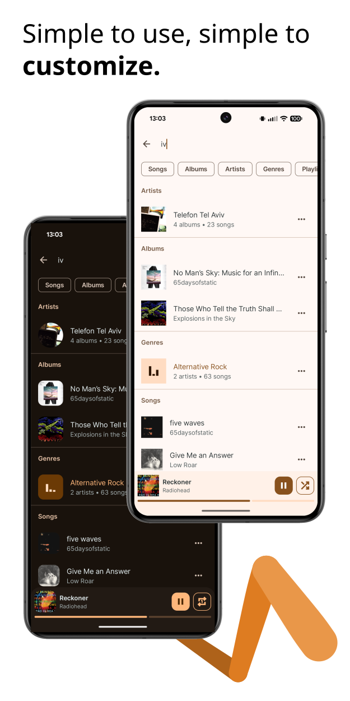
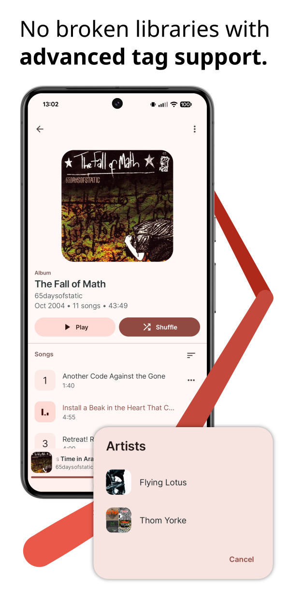
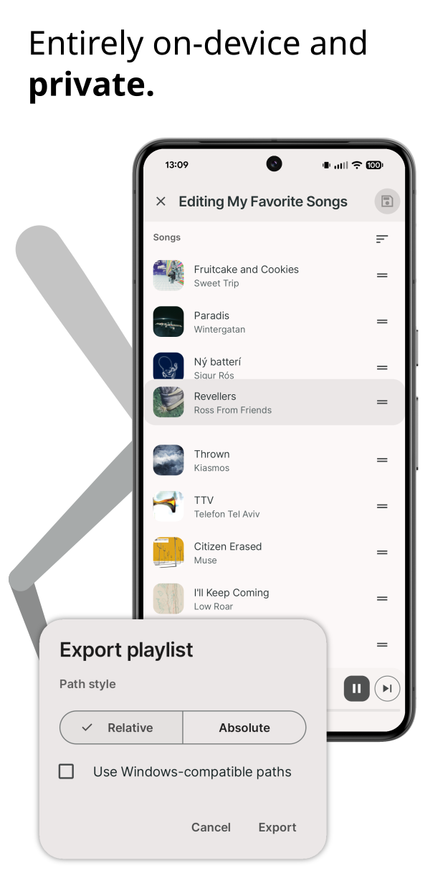

<p align="center"></p>
<h1 align="center"><b>Tonewise 知律</b></h1>
<h4 align="center">懂作品的章法，亦懂入景的直觉。Structured for works. Built for scenes. Bit-perfect to the ear.</h4>

<p align="center"></p>

## About

流媒体时代不缺音乐入口，缺的是一套真正尊重专辑叙事与录音本貌的本地听音器物。通用播放器往往按流行单曲逻辑设计：交响曲的完整乐章被随机打碎，爵士三重奏里的伴奏名家无处检索，精心抓轨的数百张无损专辑最终困在繁琐的目录层级里吃灰。

**Tonewise（知律）** 是一款面向古典、爵士与摇滚本地无损曲库打造的开源跨端本地音乐系统（GPL-3.0）。项目以 **Rust 同源核心库 (`core/`) + Windows 11 原生桌面端 (`desktop/`) + Android 深度定制端 (`android/`, 基于 [Auxio](https://github.com/OxygenCobalt/Auxio)) + `.tonewise/` 双端同步协议 (`protocol/`)** 构成“PC 重算力策展与母带直通 + 手机随身零摩擦入景 + 局域网无云同步”的完整本地听音体系。

### 当前实现状态（`com.shawnshi.tonewise` v4.1.5 · `versionCode 75`）

* **Rust 同源内核 (`core/`)**：完成 `tonewise-metadata`、`tonewise-rules`、`tonewise-dsp-core`、`tonewise-sync`、`tonewise-ffi`、`tonewise-cli` 六大 crate 构建与双端 JNI/FFI 对齐（`build-core-android.ps1` / `build-core-desktop.ps1`）。
* **Windows 11 桌面端 (`desktop/`)**：完成 `Tonewise.Desktop`、`Tonewise.Audio`、`Tonewise.Interop`、`Tonewise.SyncHost` 与 `Tonewise.Desktop.Tests`，覆盖 64-bit Biquad PEQ / EqualizerAPO 解析、150 点 Blake3 RMS 包络提取与 mDNS (`_tonewise._tcp`) 局域网同步宿主。
* **Android 客户端四阶段演进 (`android/` S1–S4)**：
  * **S1 — 64-bit 浮点调音引擎与双模直通链路**：`TonewiseDspEngine` 5 级 `Double` 串联管线（Preamp → 10 段 RBJ Biquad PEQ / EqualizerAPO 导入 → Bauer 双耳 Crossfeed → 声道平衡/相位/单声道折叠 → `-0.2 dBFS` 3ms 前瞻软限幅）、按设备声学存档（`DspRepository`）、等响度 A/B 盲听对比、Android 14+ USB DAC `BIT_PERFECT` 硬件直通与采样率切换重武装、外置 `AudioSession`（Wavelet / RootlessJamesDSP）互斥以及 HyperOS/Dolby 系统音效冲突提示。
  * **S2 — 古典多版本作品索引与原子洗牌**：`:musikr` 新增 `WORK` / `MOVEMENTNAME` / `MOVEMENTNUMBER` / `MUSICBRAINZ_WORKID` / `MOOD` 标签解析（缓存库升至 v73）、`ClassicalWork` 同作品多演绎版本聚合、屏幕 C 演绎版本对比（`WorkRecordingsDialog` 同步切歌至对应乐章与播放进度）以及整部作品不拆散的原子随机排序（`WorkShuffleOrder`）。
  * **S3 — 古典四元组排版、常驻音质胶囊与数码画册**：播放界面支持“作曲家—作品名—乐章—演绎者/指挥”古典四元组衬线排版（`Typeface.SERIF`）与 1:1 直角封面（`CoverView` / `PlaybackMaskableFrameLayout`）、常驻三色音质胶囊 `playback_quality_pill`（点击直达全链路信号路径 `SignalPathDialog`），以及基于原生 `PdfRenderer` 的零依赖 `BookletPdfDialog` 数码画册阅读器。
  * **S4 — 情景浮条热切换、`.m3u8` 防抖回写与 OLED 桌面时钟**：底部播放栏顶部新增 `SceneContextPill`（短按打开 `ScenesAndSyncDialog`，长按跨 5 槽位热切换并自适应底部弹窗高度）、五维 DJ 标签筛选（`DJ_VOCALS` / `DJ_ENERGY` / `DJ_SCENE`）、局域网 mDNS 增量同步与 150 点 SeekBar 波形包络、2 秒防抖无 BOM UTF-8 POSIX `.m3u8` 回写，以及纯黑 `#000000` 全屏 `DeskClockDialog`（每 60 秒 `±2dp` 循环像素偏移防烧屏）。

## Release Download / 发行包下载

仓库已随附最新构建并对齐签名的 Android Release 安装包：

* **安装包**：[releases/tonewise-android-release.apk](releases/tonewise-android-release.apk)
* **版本与包名**：`com.shawnshi.tonewise` · `v4.1.5` (`versionCode 75`)
* **文件大小**：`15,461,338` bytes (~14.75 MiB)
* **SHA-256**：`6c497c99a620e7bcd92c0f8e29be344131318a52b0b26c168c9d2c788370b92c`
* **签名说明**：已通过 `zipalign` 4 字节对齐与 `apksigner` v2/v3 签名校验（当前使用开发者本机调试签名密钥 `CN=Android Debug, O=Android, C=US` 封装，可直接侧载安装体验；正式商店分发请替换为独立发布密钥签章）。

## Screenshots

<p align="center">
    
    
    
    
    
    
</p>

## Current Android Features

* **Media3 & 无损软解内核**：基于定制版 [Media3 ExoPlayer](https://developer.android.com/guide/topics/media/exoplayer) + FFmpeg FLAC/ALAC 解码 + Rust `tonewise-core` JNI 原生能力
* **发烧级音频路径与 64-bit DSP**：USB DAC `BIT_PERFECT` 硬件直通、5 级 64-bit Biquad PEQ / Bauer Crossfeed / 软限幅、EqualizerAPO 导入、等响度 A/B 盲听对比与信号路径 4 段实时监控
* **古典音乐一等公民支持**：`WORK` / `MOVEMENTNAME` / `MOVEMENTNUMBER` / `MUSICBRAINZ_WORKID` / 作曲家 / 指挥深度索引、同作品多版本同乐章对比切换、原子乐章随机排序、衬线四元组视图与 `PdfRenderer` 数码画册阅读
* **多维详情与传记体系**：曲目列表展示 `album` / `year` / `play count` / `genre`；专辑、艺术家、作曲家、指挥详情页支持本地及缓存传记展示
* **五维入景与局域网零云同步**：`DJ_VOCALS` / `DJ_ENERGY` / `DJ_SCENE` 胶囊矩阵、5 槽位持久队列热切换、`_tonewise._tcp` mDNS 局域网同步、150 点静态 RMS 波形进度条、防抖 `.m3u8` 导出与 OLED 防烧屏桌面时钟
* **高完成度本地播放器基础**：Material Design Expressive 交互、SAF/MediaStore 双后端、无缝播放、完整 ReplayGain 与 Android Auto / 桌面微件支持

## Permissions

* Storage (`READ_MEDIA_AUDIO`, `READ_EXTERNAL_STORAGE` maxSdk 32) to read local music directories and liner note booklets
* Services (`FOREGROUND_SERVICE`, `FOREGROUND_SERVICE_MEDIA_PLAYBACK`, `FOREGROUND_SERVICE_DATA_SYNC`, `WAKE_LOCK`) for background playback and LAN sync
* Notifications (`POST_NOTIFICATIONS`) for ongoing media playback and library indexing status
* Local Network (`INTERNET`, `ACCESS_NETWORK_STATE`, `CHANGE_WIFI_MULTICAST_STATE`) strictly for `_tonewise._tcp` LAN SyncHost discovery/transfer and optional metadata lookup

## Workspace Structure

```text
Tonewise/
├── android/    # Android 客户端 Gradle 工程 (:app, :musikr, vendored media/, patches/)
├── core/       # Rust tonewise-core 双端同源内核与离线回填 CLI
├── desktop/    # Windows 11 原生桌面端 (.NET / C# / WinUI 3) 与 SyncHost
├── protocol/   # .tonewise/ 双端同步协议 Schema、字典与回归夹具
├── releases/   # 已构建校验的 Android Release APK 归档
├── scripts/    # 跨端构建脚本 (apply-media-patch, build-core-android, build-core-desktop)
└── docs/       # 设计方案 (specs/)、声学调研 (research/) 与视觉资产 (assets/)
```

## Building (Windows 11)

Tonewise builds natively on Windows 11 with PowerShell 7 (JDK 21, CMake 3.22.1+, Ninja, Android NDK `28.2.13676358`, Rust stable toolchain, and .NET SDK for `desktop/`).

### 1. Clone, patch Media3, and build `tonewise-core` JNI/Desktop libs

```powershell
git -c core.autocrlf=false -c core.symlinks=true -c core.longpaths=true clone --recurse-submodules https://github.com/shawnshi/Tonewise.git
cd Tonewise
.\scripts\apply-media-patch.ps1
.\scripts\build-core-desktop.ps1
.\scripts\build-core-android.ps1
```

### 2. Prepare FFmpeg static libraries once (MSYS2 UCRT64)

`musikr` builds TagLib for all four Android ABIs automatically with CMake on Windows. For the patched Media3 FFmpeg decoder, build the static libraries once inside an MSYS2 UCRT64 shell:

```bash
pacman -Syu
pacman -S --needed base-devel diffutils nasm perl mingw-w64-ucrt-x86_64-gcc

module="$(cygpath -u "$PWD/android/media/libraries/decoder_ffmpeg/src/main")"
sdk="$(cygpath -u "${ANDROID_HOME:-$LOCALAPPDATA/Android/Sdk}")"
ndk="$sdk/ndk/28.2.13676358"
bash "$module/jni/build_ffmpeg.sh" "$module" "$ndk" windows-x86_64 21 flac alac
```

### 3. Build & test Android with Gradle

```powershell
Set-Location android
.\gradlew.bat :musikr:testDebugUnitTest :app:testDebugUnitTest :app:assembleDebug
.\gradlew.bat :app:assembleRelease
```

### 4. Connecting and installing on an Android device

```powershell
adb devices
Set-Location android
.\gradlew.bat installDebug
# Or sideload the release package from repo root:
adb install -r ..\releases\tonewise-android-release.apk
```

## License

[](https://www.gnu.org/licenses/gpl-3.0.en.html)

Tonewise is Free Software: You can use, study, share and improve it at your will. Specifically you can redistribute and/or modify it under the terms of the [GNU General Public License](https://www.gnu.org/licenses/gpl.html) as published by the Free Software Foundation, either version 3 of the License, or (at your option) any later version.
