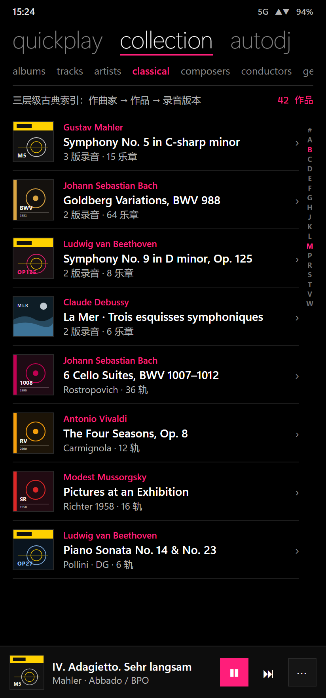
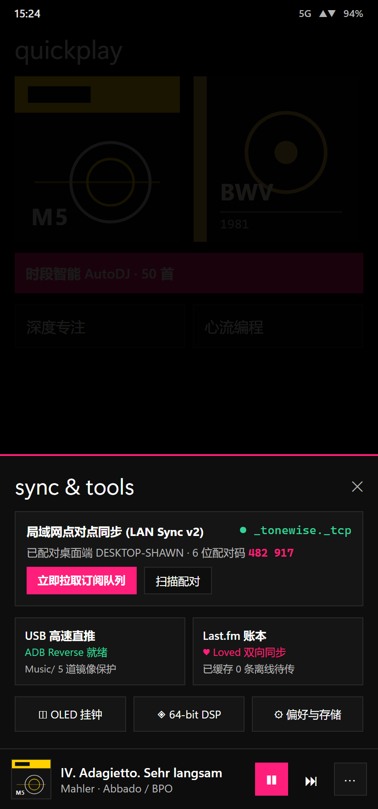

<p align="center"></p>
<h1 align="center"><b>Tonewise 知律</b></h1>
<h4 align="center">懂作品的章法，亦懂入景的直觉。Structured for works. Built for scenes. Bit-perfect to the ear.</h4>

<p align="center"></p>

## About

流媒体时代不缺音乐入口，缺的是一套真正尊重专辑叙事与录音本貌的本地听音器物。通用播放器往往按流行单曲逻辑设计：交响曲的完整乐章被随机打碎，爵士三重奏里的伴奏名家无处检索，精心抓轨的数百张无损专辑最终困在繁琐的目录层级里吃灰。

**Tonewise（知律）** 是一款面向古典、爵士与摇滚本地无损曲库打造的开源跨端本地音乐系统（GPL-3.0）。项目以 **Rust 同源核心库 (`core/`) + Windows 11 原生桌面端 (`desktop/`) + Android 深度定制端 (`android/`, 基于 [Auxio](https://github.com/OxygenCobalt/Auxio)) + `.tonewise/` 双端同步协议 (`protocol/`)** 构成“PC 重算力策展与母带直通 + 手机随身零摩擦入景 + 局域网 / USB 无云同步”的完整本地听音体系。

### 当前实现状态（Tonewise `v0.9.9` · `com.shawnshi.tonewise` `versionCode 99`）

* **Rust 同源内核 (`core/`)**：完成 `tonewise-metadata`、`tonewise-rules`、`tonewise-dsp-core`、`tonewise-sync`、`tonewise-ffi`、`tonewise-cli` 六大 crate 构建与双端 JNI/FFI 对齐（`build-core-android.ps1` / `build-core-desktop.ps1`），支持 `tonewise-ffi` 基于 `lofty` 的音频元数据原地快写路径（保留 `audio_frame_blake3` 不变并避免整文件重写卡顿）、EqualizerAPO 编号行 `Filter <n>:` 跨端统一解析，以及共享字典体系（`protocol/dictionaries/default_scenes_5d.json`、`artist_whitelist.json` 与 ICU 汉字拼音表 `hanzi_pinyin_table.txt`）。
* **Windows 11 桌面端 (`desktop/`)**：完成 P1–P4、R1–R8、数据库拆库治理、播放/挂钟全链重构、工作台编辑体验与双语种歌单匹配引擎全面升级，并新增 USB 自动双向同步与锁屏/息屏播放保活：
  * **母带级 64-bit 声学引擎 (`Tonewise.Audio`)**：Event-Driven WASAPI Exclusive / `AsioOut` 输出（修复初始化异常句柄泄漏、`_engineLock` 锁外异步释放与 `IMMNotificationClient` 设备热插拔实时重连）、基于半余弦包络的无爆音启停淡入淡出与静音缓冲排空（覆盖 Bit-Perfect 直通模式）、`.dsf`/`.dff` 原生 DSD→`352.8 kHz / 64-bit DXD`（127-tap FIR 抽取与 `.dff` 区块边界校验，停止后正确复位 `Idle — Standby` 并读取真实 `OutputWaveFormat` 位深/采样率）、Stereo Linked & L/R 独立 64 段 EqualizerAPO 热更新保留滤波器状态与 Auto-EQ 写回、`±12ms` 音量斜坡与平方律 0% 静音曲线、ISO 226 动态等响度热更新、带线性重采样/立体声联动归一化的零延迟分区 FFT FIR 卷积（支持 REW `.wav` 与 `.sofa` 双耳脉冲）、滑动峰值环 3ms Lookahead Limiter、分段隔离 ReplayGain 的无缝队列连播（`GaplessSampleProvider`）、古典整部作品与指挥粒度原子随机排序（`WorkAwareShuffleEngine`）、统一睡眠定时引擎（`SleepTimerEngine`：15/30/45/60 分钟最后 10 秒淡出、本曲结束、本古典作品结束），以及 **Windows 11 Modern Standby 锁屏/息屏保活与自愈恢复**（`WindowsPlaybackPowerGuard` 内核级 `PowerRequestExecutionRequired` + `PowerRequestSystemRequired` 防止 DAM 挂起且不阻断息屏、`WasapiMediaCategoryHelper` 声明 `IAudioClient2` `AudioCategory_Media`、`AudioEndpointReconciler` 原位差量端点对账防显示器音频休眠抖动、`PlaybackInterrupted` 精确进度捕获与有界 3 次退避自愈重连/临时共享回退及 60 秒设备回归自动续播）。
  * **音乐信息维护与双库分离架构 (`Tonewise.SyncHost`)**：采用 `manifest.db`（曲库只读索引）与 `desktop_state.db`（`DesktopStateStore` 队列/同步/配对状态库，经统一 `SqliteConnectionFactory` 执行 WAL 与 busy-timeout 治理）物理分库；入库审校台支持 `lofty` 物理音频文件头原地事务快写与批量并行保存（保持纯音频 `audio_frame_blake3` 不变）及回滚、超长路径（`\\?\`）与防抖 `FileSystemWatcher` 实时曲库监测、Spotify/Apple Music/Billboard/Kworb/TXT/M3U8 歌单导入、多源元数据与传记库，以及带 `_tonewise._tcp` mDNS + Bearer Token 6 位配对码的持久化幂等 LAN Sync v2（五类同步粒度、`Range` 分发、PC→手机单向歌单同步默认拒绝手机回传、解析清单透传作曲家/指挥/作品/乐章古典字段）和 BOM-free 相对路径 `.m3u8` 导出；新增 **USB 自动双向同步 (`UsbAdbBridge` + `UsbAutoSyncCoordinator` + 高吞吐直推客户端 `UsbAdbSyncClient`)**，手机连接电脑后自动建立 ADB Reverse 隧道复用 LAN Sync v2 与高吞吐 USB 直推通道（持久化 `subscribe` 同步列表、PC→手机音频与歌单严格镜像及 `Music/` 目录自动清理 5 道安全熔断与可选 ADB 外来文件兜底删除、手机⇄PC 播放次数/Last.fm 账本、LWW 五维标签/评分与 5 槽位场景接力双向同步）；内置全面升级的 PC 歌单匹配引擎，支持拉丁变音符折叠与 `LCMapStringEx` 繁简归一、`FormKC` 全角标点与罗马数字折合、共享 ICU `HanziPinyinConverter` 艺人锚定双向汉字↔拼音匹配与中文 `与`/`乐队/乐团/组合` 归一、CJK 斜杠串烧拆分与 `1-01` 碟片曲序剥离、`PlaylistStore` UTF-8→Win32 `MultiByteToWideChar` GB18030/GBK 回退解码、独立 `workName` 索引、`IsGenericClassicalMovementLabel` 跨作品乐章/速度标题守卫、多语种（西/英/法/日/韩/双语 `" - "`）版本后缀清理、西里尔字母 `ё→е` 折叠、单向 `Remix`/`Acoustic` 软回退、`artist_whitelist.json` 复合艺人保护拆分、Live/专辑/时长/无损音质多维优选、空艺人冲突防护，以及 `PlaylistStore.RematchPlaylist` / `RematchAllPlaylists` 幂等原地写回。
  * **曜石黑工作台与 OLED 壁挂钟 (`Tonewise.Desktop`)**：`#131720` + `#D9B372` 高密度三栏工作台（标题栏矢量音叉声波徽章与精简顶栏菜单区）；曲目列表支持 Windows 常用多选与快捷键体系（`Ctrl`/`Shift` 连选与跳选、`Ctrl+A` 全选、`Ctrl+Z`/`Ctrl+Y` 50 步标签编辑撤销/重做、`Ctrl+S` 保存、`Ctrl+C` 复制）、单/多曲并行快速写回及原地局部行刷新（消除编辑保存后的整表重刷与界面闪烁）；AutoDJ 仅入队排曲不自动写盘 `.m3u8`、歌单工作区支持一键 **“重匹曲库”** / 右键 **“重匹本地曲库并保存”**，并在重建指纹库、标签撤回及整理曲库文件夹后联动刷新与修复歌单路径；同步面板新增 USB 连接/直推/镜像清理实时状态与作用域开关（`Music/` 全量镜像 / 仅托管文件 / 外来文件 ADB 兜底开关）；底部睡眠定时与焦点防护热键（`Ctrl+Alt+P/C/M`）；独立纯黑 `#000000` `DeskClockWidgetWindow` 支持悬浮伴侣窗与 `F11`/`Esc` 全屏壁挂钟双形态、HiDPI `GetDpiForWindow` 缩放、`SetThreadExecutionState` 防熄屏（暂停 10 分钟或睡眠定时到期自动释放）、16 点 `±12 DIP` 防烧屏轨道、封面与古典三层元数据展示及全屏 10 秒无操作自动隐栏。
* **Android 客户端四阶段演进 (`android/` S1–S4 及 v0.9.5 / v0.9.9 增强)**：
  * **S1 — 64-bit 浮点调音引擎与双模直通链路**：通过 `media-float-dsp-processors.patch` 修复 Media3 `DefaultAudioSink` 浮点输出分支确保自定义 `AudioProcessor` 全链运行，`TonewiseDspEngine` 提供 `C¹` 连续软限幅、IIR 系数热更新、滑动峰值环 Lookahead + `onQueueEndOfStream()` 尾帧排空、EqualizerAPO 编号行导入与桌面端一致预设、等响度 A/B 盲听对比、API 33+/34+ 路由实测与 USB DAC Mixer 位深一致校验。
  * **S2 — 古典多版本作品索引与原子洗牌**：`:musikr` 深度解析 `WORK` / `MOVEMENTNAME` / `MOVEMENTNUMBER` / `MUSICBRAINZ_WORKID` / `MOOD`（缓存库升级至 v75 两阶段冷启动加载）、`ClassicalWork` 多版本对比切曲、按指挥维度隔离合辑同作品录音块的 `WorkShuffleOrder` 原子洗牌与动态 ReplayGain 对齐；修复设置曲库目录时未立即触发扫描与 SAF 只读权限回退，并移除首页顶栏冗余排序按钮。
  * **S3 — 古典四元组排版与数码画册**：播放页呈现“作曲家—作品名—乐章—演绎者/指挥”衬线排版、`SignalPathDialog` 真实链路面板与原生 `PdfRenderer` `BookletPdfDialog` 数码画册阅读器。
  * **S4 — 独立情景与专注页签、Auto DJ 场景电台、波形进度条、局域网 / USB 同步中心、歌单本地匹配升级、后台保活、睡眠定时与 OLED 挂钟体系**：`Library` 新增独立 **Scenes** 与 **Focus** 页签、作曲家/指挥家专属排序视图与 5 槽位场景热切；**Scenes** 界面重塑为时段感知 **50 首 `AutoDjEngine` 情景播放列表生成** 并引入独立 **Auto DJ** 入口；播放进度条升级为桌面端同款 **150 段声学波形 + 进度条**（`WavySlider` / `StyledSeekBar`，由端侧 `LocalWaveformExtractor` 实时提取并写入 `WaveformRepository`）；歌单本地匹配对齐 PC 端（`AndroidPlaylistTrackMatcher` + `HanziPinyinConverter` + 内置 `hanzi_pinyin_table.txt`/`artist_whitelist.json`，升级 `AutoPlaylistImporter` `v3` 与 `M3U` 路径解析）；同步中心集成 `TonewiseSyncDatabase`（导出的 Room `schemas/` 迁移治理）、`SecretBox` / `LwwMutationStore` / `LanSyncForegroundService`（遵循 PC→手机单向歌单同步与 `ManagedSyncStorage` 托管清理）、**USB 自动同步触发服务 (`UsbSyncTriggerService` 接收 PC ADB 广播自动执行双向同步与高速直推落盘)** 与 **`Music/` 镜像清理规划器 (`SyncMirrorPrunePlanner` 五道安全熔断并自动删除非同步列表歌曲)**；修复 MediaSession 100 首队列滑窗、Last.fm 50%/4 分钟 Scrobble 门槛、瞬时音频焦点丢失状态抑制、`WaveformRepository` 60 秒负缓存/2048 LRU 指纹缓存；升级 `AuxioService` 后台与锁屏播放保活（`onUnbind`/`onRebind`、`ServiceLifecyclePolicy` 立即转前台、`MediaSessionHolder` 异步解码不阻塞文本/通知下发、`FOREGROUND_SERVICE_IMMEDIATE` 及 Android 13+ 通知权限引导）；支持主页顶栏常驻进入与独立 `TonewiseDreamService` OLED 充电屏保、`DeskClockDialog` 150 点可拖拽波形进度条、视口等比大字号、系统 12/24h 秒边界对齐、10 秒控件隐去及联动释锁的 `SleepTimerController`。

## Release Download / 发行包下载

仓库已随附最新构建并校验的双端 Release 发行包：

| 平台 | 安装包 / 发行归档 | 版本与运行环境 | 文件大小 | SHA-256 |
| :--- | :--- | :--- | :--- | :--- |
| **Android** | [releases/tonewise-android-release.apk](releases/tonewise-android-release.apk) | `com.shawnshi.tonewise` · `v0.9.9` (`versionCode 99`) | `16,181,459` bytes (~15.43 MiB) | `d37b4d20c61d3f0d5e08c5044e5d945896f7ed72e9629266cb3c40d2f63d5447` |
| **Windows x64** | [releases/tonewise-windows-x64-release.zip](releases/tonewise-windows-x64-release.zip) | `v0.9.9` · WinUI 3 (`net9.0-windows10.0.26100.0` + 含 `tonewise_core.dll` & `tonewise-cli.exe`) | `50,824,202` bytes (~48.47 MiB) | `1327d0a7099b4de608b04f00371c1ab050fc8fc6edbb97ac64dca114d3d25b0b` |

* **Android 签名说明**：已通过 `zipalign` 4 字节对齐与 `apksigner` v2 签名校验（当前随包产物使用本地调试签名密钥封装；仓库已支持 `TONEWISE_RELEASE_*` 独立发布签名与 `-PrequireReleaseSigning` 严格校验，本地无签名调试构建可传 `-PuseDebugSigning`）。
* **Windows x64 运行说明**：解压 `tonewise-windows-x64-release.zip` 后直接运行 `Tonewise.Desktop.exe`（需安装 .NET 9 Desktop Runtime；Windows App SDK 1.7 与 Rust `tonewise_core.dll` / `tonewise-cli.exe` 已随压缩包自包含打包；使用 USB 自动同步时将自动探测随包 `tools\adb.exe`、系统 `PATH` 或本机 Android SDK `platform-tools\adb.exe`）。

## Screenshots

### Android 移动端（核心界面）

| 情景与专注导航 | 专辑与曲库浏览 | 古典四元组播放与波形进度条 |
| :---: | :---: | :---: |
|  |  |  |
| **64-bit 浮点参量均衡与调音引擎** | **Focus 正反选布尔漏斗** | **5 槽位接力、Last.fm 与局域网同步** |
|  |  |  |

### Windows 桌面端（工作台精选）

| 桌面曲库与增强播放栏 | 古典作品与多版本演绎 |
| :---: | :---: |
|  |  |
| **场景编排与 AutoDJ** | **局域网 6 位配对码与精细化同步** |
|  |  |

## Current Android Features

* **Media3 & 无损软解内核**：基于定制版 [Media3 ExoPlayer](https://developer.android.com/guide/topics/media/exoplayer)（含 `media-float-dsp-processors.patch` 浮点处理链修复）+ FFmpeg FLAC/ALAC 解码 + Rust `tonewise-core` JNI 原生能力
* **发烧级音频路径与 64-bit DSP**：USB DAC `BIT_PERFECT` 硬件直通与 Mixer 位深实测、5 级 64-bit 热更新 Biquad PEQ / Bauer Crossfeed / 滑动峰值环 Lookahead `C¹` 软限幅、`onQueueEndOfStream` 尾帧排空、EqualizerAPO 编号行导入与桌面端一致预设、等响度 A/B 盲听对比与信号路径实时监控
* **古典音乐一等公民支持**：`WORK` / `MOVEMENTNAME` / `MOVEMENTNUMBER` / `MUSICBRAINZ_WORKID` / 作曲家 / 指挥深度索引、独立作曲家/指挥家视图与专项排序（`PersonListFragment` / `ComposerSortDialog` / `ConductorSortDialog`）、同作品多版本同乐章对比切换、按指挥区分的原子乐章随机排序、衬线四元组视图与 `PdfRenderer` 数码画册阅读
* **多维详情与传记体系**：曲目列表展示 `album` / `year` / `play count` / `genre`；专辑、艺术家、作曲家、指挥详情页支持本地及缓存传记展示
* **极速冷启动、时段感知 Auto DJ、端侧波形进度条、歌单精准匹配、局域网 / USB 零云同步、后台保活与 OLED 挂钟 / 睡眠定时**：`CacheDatabase` v75 两阶段瞬时加载、选定曲库目录即时触发扫描与后台静默刷新，**Scenes** 50 首时段感知 `AutoDjEngine` 与独立 **Auto DJ** 入口、**Focus** 页签与 `QuickTagDialog` 快捷五维打标、150 段端侧实时波形进度条（`LocalWaveformExtractor` + `WavySlider`）、`AndroidPlaylistTrackMatcher` 双向汉字拼音与跨语种歌单精准匹配（内置 `hanzi_pinyin_table.txt` 与 `artist_whitelist.json`）、`TonewiseSyncDatabase` Schema 治理、Last.fm 50%/4 分钟 Scrobble 门槛与离线队列、`_tonewise._tcp` mDNS + `SecretBox` 安全配对单向歌单同步、`UsbSyncTriggerService` USB 自动双向同步与高速直推落盘及 `SyncMirrorPrunePlanner` `Music/` 文件夹严格镜像清理（5 道安全熔断）、100 首 MediaSession 队列滑窗、`AuxioService` 锁屏/后台播放保活（立即转前台与非阻塞通知更新）、`WaveformRepository` 负缓存与 2048 LRU 指纹缓存、可拖拽 150 点波形挂钟 `DeskClockDialog`、独立 `TonewiseDreamService` 充电屏保及统一睡眠定时（`SleepTimerController`）
* **高完成度本地播放器基础**：Material Design Expressive 交互、SAF/MediaStore 双后端、无缝播放、完整 ReplayGain 与 Android Auto / 桌面微件支持

## Permissions

* Storage (`READ_MEDIA_AUDIO`, `READ_EXTERNAL_STORAGE` maxSdk 32) to read local music directories and liner note booklets
* Services (`FOREGROUND_SERVICE`, `FOREGROUND_SERVICE_MEDIA_PLAYBACK`, `FOREGROUND_SERVICE_DATA_SYNC`, `WAKE_LOCK`) for background playback and LAN sync
* Notifications (`POST_NOTIFICATIONS`) for ongoing media playback and library indexing status
* Local Network (`INTERNET`, `ACCESS_NETWORK_STATE`, `CHANGE_WIFI_MULTICAST_STATE`) strictly for `_tonewise._tcp` LAN SyncHost discovery/transfer and optional metadata lookup

## Workspace Structure

```text
Tonewise/
├── android/    # Android 客户端 Gradle 工程 (:app, :musikr, vendored media/, patches/)
├── core/       # Rust tonewise-core 双端同源内核与离线回填 CLI
├── desktop/    # Windows 11 原生桌面端 (.NET / C# / WinUI 3) 与 SyncHost
├── protocol/   # .tonewise/ 双端同步协议 Schema、字典与回归夹具
├── releases/   # 已构建校验的 Android APK 与 Windows x64 ZIP 归档
├── scripts/    # 跨端构建脚本 (apply-media-patch [windows-ffmpeg + float-dsp-processors], build-core-android, build-core-desktop)
└── docs/       # 设计方案 (specs/)、声学调研 (research/) 与视觉资产 (assets/)
```

## Building (Windows 11)

Tonewise builds natively on Windows 11 with PowerShell 7 (JDK 21, CMake 3.22.1+, Ninja, Android NDK `28.2.13676358`, Rust stable toolchain, and .NET SDK for `desktop/`).

### 1. Clone, patch Media3, and build `tonewise-core` JNI/Desktop libs

```powershell
git -c core.autocrlf=false -c core.symlinks=true -c core.longpaths=true clone --recurse-submodules https://github.com/shawnshi/Tonewise.git
cd Tonewise
.\scripts\apply-media-patch.ps1
.\scripts\build-core-desktop.ps1
.\scripts\build-core-android.ps1
```

### 2. Prepare FFmpeg static libraries once (MSYS2 UCRT64)

`musikr` builds TagLib for all four Android ABIs automatically with CMake on Windows. For the patched Media3 FFmpeg decoder, build the static libraries once inside an MSYS2 UCRT64 shell:

```bash
pacman -Syu
pacman -S --needed base-devel diffutils nasm perl mingw-w64-ucrt-x86_64-gcc

module="$(cygpath -u "$PWD/android/media/libraries/decoder_ffmpeg/src/main")"
sdk="$(cygpath -u "${ANDROID_HOME:-$LOCALAPPDATA/Android/Sdk}")"
ndk="$sdk/ndk/28.2.13676358"
bash "$module/jni/build_ffmpeg.sh" "$module" "$ndk" windows-x86_64 21 flac alac
```

### 3. Build & test Android with Gradle

```powershell
Set-Location android
.\gradlew.bat :musikr:testDebugUnitTest :app:testDebugUnitTest :app:assembleDebug
# Release APK (requires TONEWISE_RELEASE_STORE_FILE / TONEWISE_RELEASE_STORE_PASSWORD / TONEWISE_RELEASE_KEY_ALIAS / TONEWISE_RELEASE_KEY_PASSWORD; fail-closed with -PrequireReleaseSigning)
.\gradlew.bat :app:assembleRelease -PrequireReleaseSigning
# Local smoke-test Release APK signed with debug keystore when no release keystore is configured:
.\gradlew.bat :app:assembleRelease -PuseDebugSigning
```

### 4. Connecting and installing on an Android device

```powershell
adb devices
Set-Location android
.\gradlew.bat installDebug
# Or sideload the release package from repo root:
adb install -r ..\releases\tonewise-android-release.apk
```

### 5. Build & test Windows Desktop (`desktop/`)

```powershell
cargo test --manifest-path core\Cargo.toml --workspace
cargo build --manifest-path core\Cargo.toml --release -p tonewise-ffi -p tonewise-cli
dotnet build desktop\Tonewise.sln -c Release -p:Platform=x64
dotnet test desktop\Tonewise.sln
```

## License

[](https://www.gnu.org/licenses/gpl-3.0.en.html)

Tonewise is Free Software: You can use, study, share and improve it at your will. Specifically you can redistribute and/or modify it under the terms of the [GNU General Public License](https://www.gnu.org/licenses/gpl.html) as published by the Free Software Foundation, either version 3 of the License, or (at your option) any later version.
