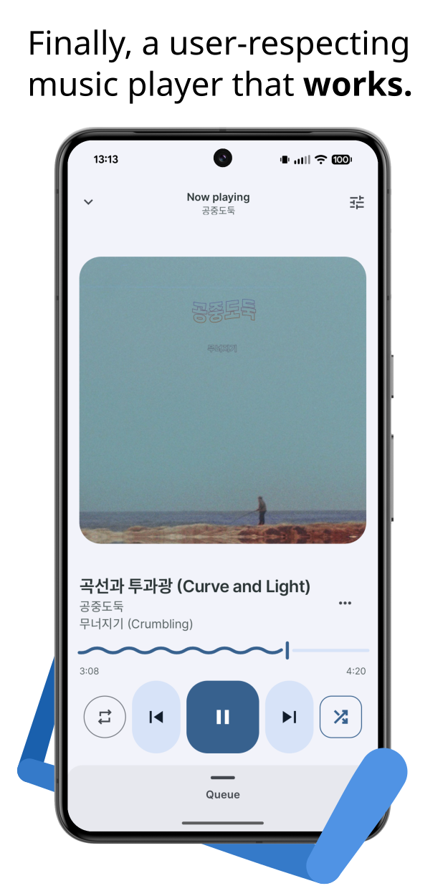
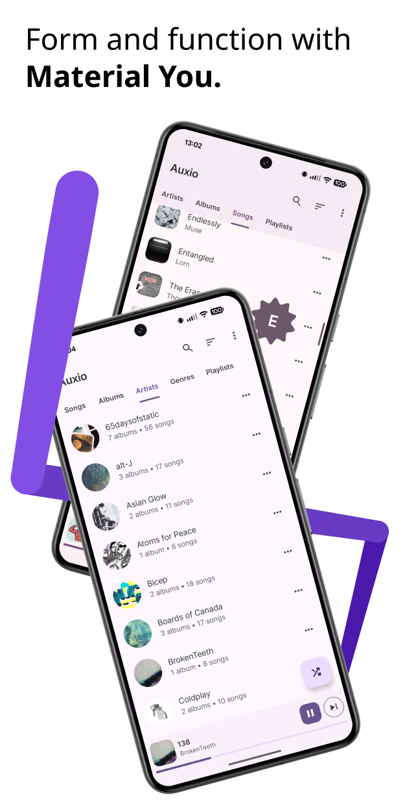
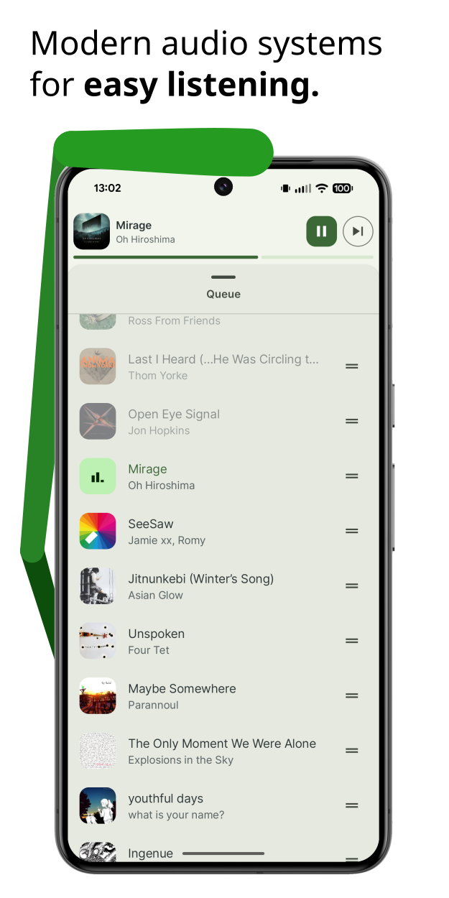

<p align="center"></p>
<h1 align="center"><b>Tonewise 知律</b></h1>
<h4 align="center">懂作品的章法，亦懂入景的直觉。Structured for works. Built for scenes. Bit-perfect to the ear.</h4>

<p align="center"></p>

## About

流媒体时代不缺音乐入口，缺的是一套真正尊重专辑叙事与录音本貌的本地听音器物。通用播放器往往按流行单曲逻辑设计：交响曲的完整乐章被随机打碎，爵士三重奏里的伴奏名家无处检索，精心抓轨的数百张无损专辑最终困在繁琐的目录层级里吃灰。

**Tonewise（知律）** 是一款面向古典、爵士与摇滚本地无损曲库打造的开源跨端本地音乐系统（GPL-3.0），Android 端基于 [Auxio](https://github.com/OxygenCobalt/Auxio) 架构演进，并规划协同 Rust 同源内核与 Windows 11 原生桌面工作台，构成“PC 重算力策展与母带直通 + 手机随身零摩擦入景 + `/Music/.tonewise/` 零云端双端同步”的完整听音体系。

### 当前基线与演进路线

* **已就绪基线（Android `com.shawnshi.tonewise` v4.1.5）**：完成品牌与包名迁移、Monorepo 多端目录分区（`android/`、`core/`、`desktop/`、`protocol/`、`scripts/`、`docs/`），以及 Windows 11 原生交叉编译链路改造（TagLib 自动构建脚本 + Media3 FFmpeg 静态库复用补丁）。
* **演进路线（M1–M5，详见 `docs/specs/`）**：
  * **M1–M2 (`core/`)**：Rust `tonewise-core` 双端同源内核与离线算力 CLI（五维标签 `DJ_ENERGY` / `DJ_SCENE` / `DJ_VOCALS` / `Tempo` / `Mood` 治理、BPM 瞬态回填、`rsgain`、150 点静态包络波形提取）。
  * **M3 & M5 (`desktop/` & `android/`)**：WinUI 3 原生工作台与 WASAPI Exclusive / ASIO Native DSD 直通；Android 32-bit 浮点管线、USB DAC `BIT_PERFECT` 直通、古典“作曲家—作品号—乐章”四元排版、Booklet PDF 阅读、全幅场景横幅与多会话队列。
  * **M4 (`protocol/`)**：基于 `/Music/.tonewise/` 与局域网 HTTP/2 的 Header-Only 标签微补丁同步、`.m3u8` 有序三路归并与 Handoff 播放接力。

## Screenshots

<p align="center">
    
    
    
    
    
    
</p>

## Current Android Features

* Playback based on [Media3 ExoPlayer](https://developer.android.com/guide/topics/media/exoplayer) with FFmpeg FLAC/ALAC decoding
* Snappy UI derived from Material Design Expressive guidelines
* Opinionated UX that prioritizes ease of use over edge cases
* Support for disc numbers, multiple artists, release types, precise/original dates, sort tags, and more
* Advanced artist system that unifies artists and album artists
* SD Card / SAF-aware folder management and MediaStore backend option
* Reliable playlisting functionality (M3U/M3U8 import & export)
* Playback state persistence and Android Auto support
* Automatic gapless playback and full ReplayGain support (MP3, FLAC, OGG, OPUS, MP4)
* External equalizer support (ex. Wavelet / RootlessJamesDSP via AudioSession)
* Embedded covers support, search filtering, headset autoplay, and adaptive home widgets
* Completely private and offline (no network permissions)

## Permissions

* Storage (`READ_MEDIA_AUDIO`, `READ_EXTERNAL_STORAGE`) to read and play your music files
* Services (`FOREGROUND_SERVICE`, `WAKE_LOCK`) to keep the music playing in the background
* Notifications (`POST_NOTIFICATION`) to indicate ongoing playback and music loading

## Workspace Structure

```text
Tonewise/
├── android/    # Android 客户端 Gradle 工程 (:app, :musikr, vendored media/, patches/)
├── core/       # [M1-M2] Rust tonewise-core 双端同源内核与离线回填 CLI
├── desktop/    # [M3-M5] Windows 11 原生 WinUI 3 (.NET 8) 桌面端
├── protocol/   # .tonewise/ 同步协议 Schema、词典与双端一致性测试夹具
├── scripts/    # 跨端联合构建与子模块补丁脚本
└── docs/       # 设计方案 (specs/)、声学调研 (research/) 与视觉资产 (assets/)
```

## Building (Android on Windows 11)

Tonewise's Android client lives under `android/` and relies on a patched version of Media3 alongside TagLib for metadata parsing. Daily development, TagLib builds, and CI run natively on Windows 11 with PowerShell 7 and Android Studio (no WSL or Linux VM required). Install JDK 21, CMake 3.22.1 or newer, Ninja, and Android NDK `28.2.13676358` through the Android SDK Manager.

### 1. Clone and apply the Windows Media3 patch

```powershell
git -c core.autocrlf=false -c core.symlinks=true -c core.longpaths=true clone --recurse-submodules https://github.com/shawnshi/Tonewise.git
cd Tonewise
.\scripts\apply-media-patch.ps1
```

### 2. Prepare FFmpeg static libraries once (MSYS2 UCRT64)

`musikr` builds TagLib for all four Android ABIs automatically with CMake on Windows when `assembleDebug` runs. For the patched Media3 FFmpeg decoder, build the static libraries once inside an MSYS2 UCRT64 shell:

```bash
pacman -Syu
pacman -S --needed base-devel diffutils nasm perl mingw-w64-ucrt-x86_64-gcc

module="$(cygpath -u "$PWD/android/media/libraries/decoder_ffmpeg/src/main")"
sdk="$(cygpath -u "${ANDROID_HOME:-$LOCALAPPDATA/Android/Sdk}")"
ndk="$sdk/ndk/28.2.13676358"
bash "$module/jni/build_ffmpeg.sh" "$module" "$ndk" windows-x86_64 21 flac alac
```

### 3. Build and install with Gradle / Android Studio

```powershell
Set-Location android
.\gradlew.bat assembleDebug
```

For Android Studio, open the `android/` directory and select JDK 21. Subsequent builds reuse the generated native artifacts.

#### Connecting and installing on an Android Device

1. Enable **Developer Options** and **USB debugging** on your phone.
2. Verify connection:

```powershell
adb devices
```

3. Install the debug build from `android/`:

```powershell
Set-Location android
.\gradlew.bat installDebug
```

4. Optional — push local music for testing:

```powershell
adb push .\Music\ /sdcard/Music
```

## License

[](https://www.gnu.org/licenses/gpl-3.0.en.html)

Tonewise is Free Software: You can use, study, share and improve it at your will. Specifically you can redistribute and/or modify it under the terms of the [GNU General Public License](https://www.gnu.org/licenses/gpl.html) as published by the Free Software Foundation, either version 3 of the License, or (at your option) any later version.
