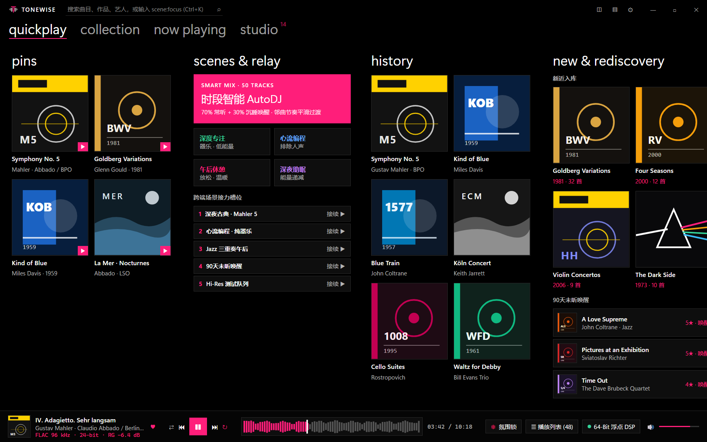
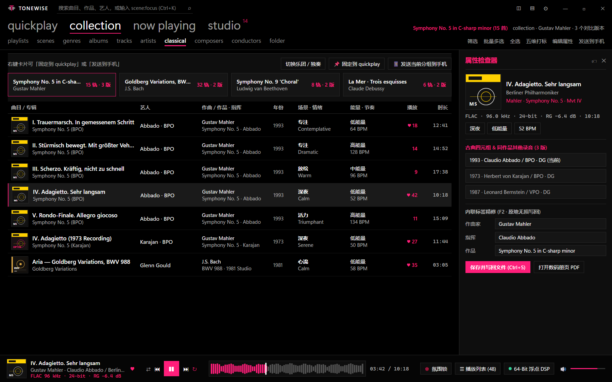
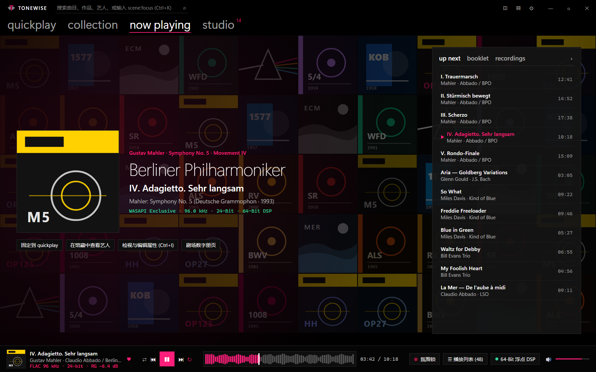
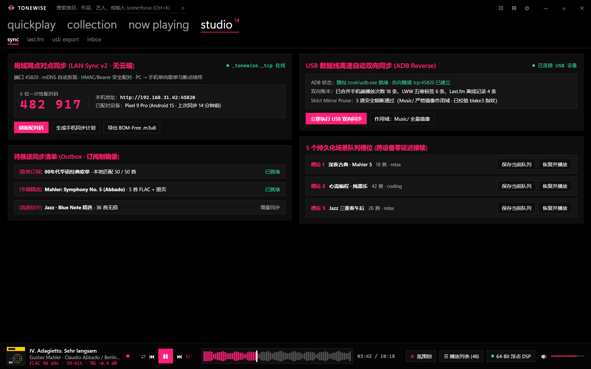

# desktop — Tonewise Windows 11 原生桌面端

基于 .NET 9 / C# / WinUI 3 的 Windows 11 原生桌面端工程与同步宿主（`Tonewise.sln`）：

- **src/Tonewise.Desktop**：基于 WinUI 3 `ExtendsContentIntoTitleBar` 的 Zune / Metro 纯黑数字美学工作台（`quickplay · collection · now playing · studio` 一级枢纽与 10 维 `collection` 子视图、`CoverArtImageCache` + 单遍封面探测、`ZuneMosaicRenderer` 专辑拼贴画廊与可收起队列、`ZuneMotionHelper` 硬件合成动效、两阶段异步冷启动、属性检查器与独立纯黑 OLED 壁挂钟 `DeskClockWidgetWindow`）。
- **src/Tonewise.Audio**：64-bit `BiquadFilter64` 参数均衡、EqualizerAPO 解析、FIR/SOFA 零延迟卷积、Modern Standby 锁屏/息屏播放保活（`WindowsPlaybackPowerGuard` / `WasapiMediaCategoryHelper` / `AudioEndpointReconciler`）与 Event-Driven WASAPI Exclusive / ASIO 输出组件。
- **src/Tonewise.SyncHost**：mDNS (`_tonewise._tcp`) 服务广播、局域网 HTTP 同步宿主（LAN Sync v2）、基于 ADB Reverse 的 USB 自动双向同步组件（`Usb/`）及双语种歌单匹配与 Zune 导航/聚合逻辑（`Workbench/`）。
- **src/Tonewise.Interop**：对接 `core/` 产出的 `tonewise_core.dll` P/Invoke 封装。
- **tests/Tonewise.Desktop.Tests**：桌面端核心模块单元测试（201 项测试全覆盖）。

```powershell
dotnet test desktop/Tonewise.sln -p:Platform=x64
```

## 界面设计预览 (Zune / Metro UI Mockups)

| Quickplay 速播全景与封面直达墙 | Collection 馆藏 · 古典作品与属性检查器 |
| :---: | :---: |
|  |  |
| **Now Playing 专辑拼贴画廊与可收起队列** | **Studio 工坊 · 局域网与 USB 自动双向同步** |
|  |  |
