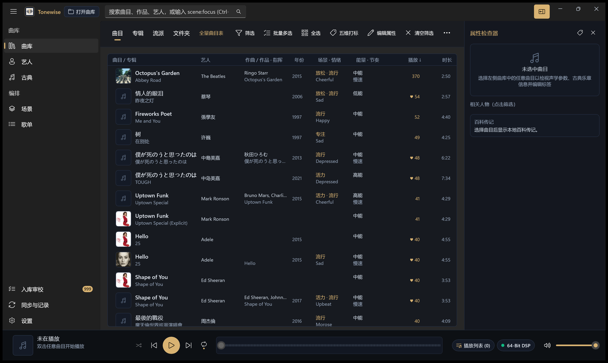
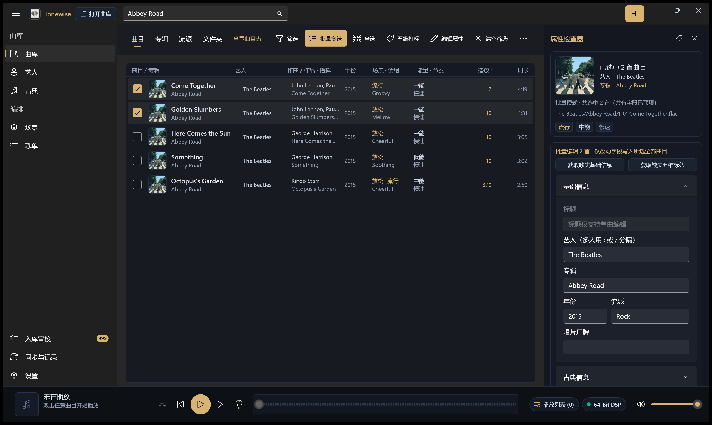
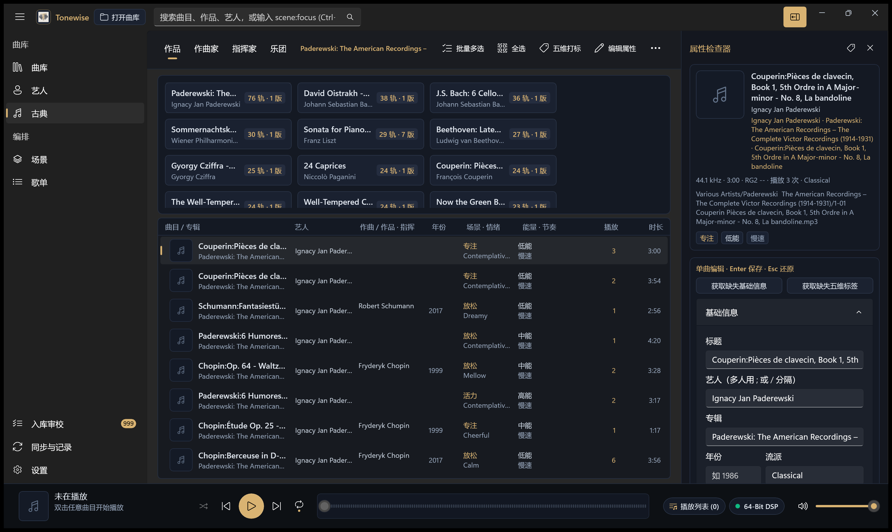
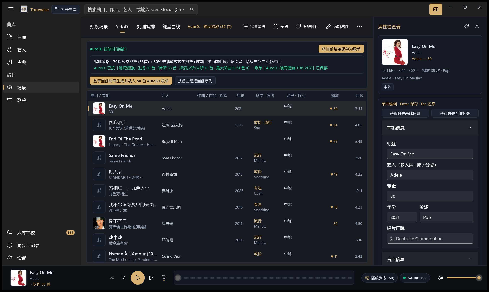
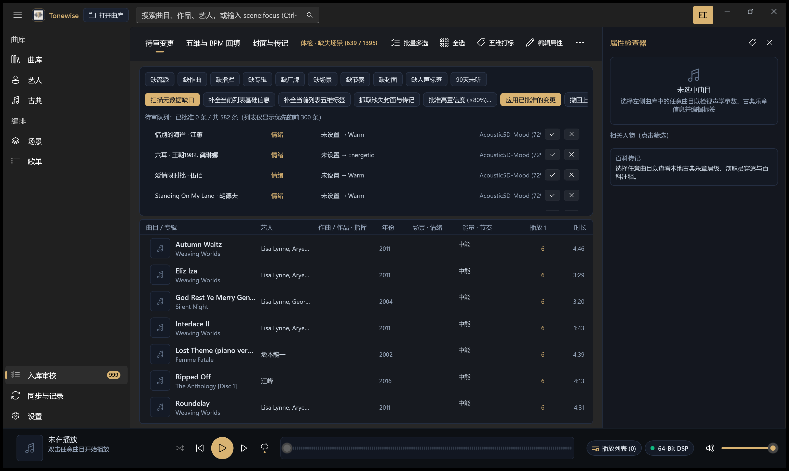
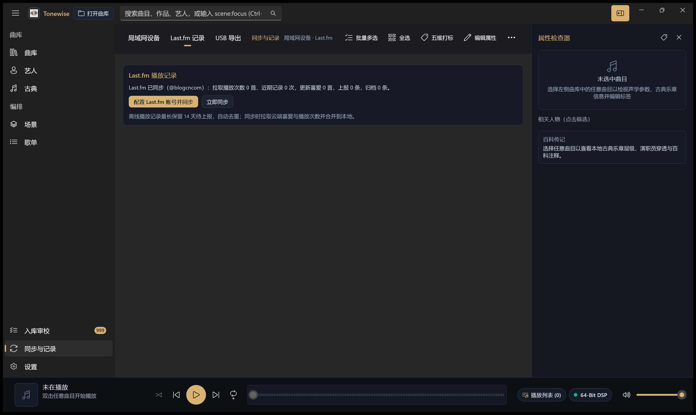

# desktop — Tonewise Windows 11 原生桌面端

基于 .NET / C# 的桌面端工程与局域网同步宿主（`Tonewise.sln`）：

- **src/Tonewise.Desktop**：桌面工作台与曲库/情景视图。
- **src/Tonewise.Audio**：64-bit `BiquadFilter64` 参数均衡、EqualizerAPO 解析与桌面音频输出组件。
- **src/Tonewise.SyncHost**：mDNS (`_tonewise._tcp`) 服务广播与局域网 HTTP 同步宿主。
- **src/Tonewise.Interop**：对接 `core/` 产出的 `tonewise_core.dll` P/Invoke 封装。
- **tests/Tonewise.Desktop.Tests**：桌面端核心模块单元测试。

```powershell
dotnet test desktop/Tonewise.sln
```

## 界面预览 (Screenshots)

| 曲库与列头排序 | 批量多选与属性精修 |
| :---: | :---: |
|  |  |
| **古典作品与四元组检查器** | **场景编排与 AutoDJ** |
|  |  |
| **入库审校与缺标体检** | **Last.fm 与局域网同步** |
|  |  |
